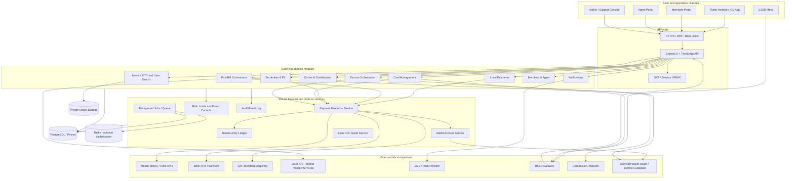

# SUREPESA — Inside-Out Product, UX, API & Backend System Specification

**Document type:** Product Requirements + UX Interaction Map + Technical Architecture + Data Dictionary + Integration & Test Specification  
**Version:** 1.0  
**Prepared:** 19 November 2026  
**Repository:** `elonixtz-dotcom/Surepesa`  
**Baseline:** Existing public `main`-branch structure as described in the preceding repository review. The GitHub account is not connected in this work session; this document does not modify the repository.

---

## 0. How to read this document

This is the working source of truth for explaining how SurePesa should operate from the user's first tap through to the database, financial ledger, external provider and final notification.

Every user action is described using the same chain:

1. **Frontend:** what the user sees, taps, enters and reviews.
2. **API:** the request the Flutter app sends and the response it receives.
3. **Backend:** authentication, permission checks, validation, business rules and the algorithm executed.
4. **Database:** what is read, created, updated or appended, including key fields and constraints.
5. **External rail:** which provider, network, bank, issuer, USSD or voice partner is contacted, if any.
6. **Outcome:** what the app displays, what the recipient sees and what is recorded in history.

### 0.1 Status labels

- **EXISTING:** described as present in the repository baseline review. It still requires a fresh build/test after GitHub is connected.
- **EXTEND:** an existing foundation should be extended rather than replaced.
- **NEW:** proposed code, screen, API, model or integration not yet implemented.
- **PARTNER-DEPENDENT:** requires a signed commercial/technical agreement, credentials, certification or regulatory approval.
- **FUTURE:** intentionally outside the first live release.

A feature being described here does **not** mean it has already been coded. This document is a design and implementation specification, not a report of completed implementation.

### 0.2 Approved product structure

SurePesa has **six product capabilities** in the current approved scope:

1. Local Payments & Wallet Management
2. PushBill ★ — founder-proposed differentiator
3. Borderless Payments
4. Circles ★ — open creation of purpose-based groups
5. Virtual Cards & Online Payments
6. Escrow ★ — protected transactions with a dedicated Escrow Wallet ledger and custody arrangement

Shared capabilities—identity, search, ledger, payment providers, voice, USSD, notifications, merchant tools, agent tools, admin, risk and reconciliation—support all six. They are not additional product pillars.

### 0.3 Non-negotiable product rules

- **Provider neutrality:** the user chooses the supported provider/payment source. SurePesa may show fees, speed estimates and availability, but cannot silently substitute a different provider after the user chooses.
- **No fake success:** a client screenshot, SMS or user statement is not proof that an external payment succeeded. Success requires trusted provider confirmation and reconciliation rules.
- **Fail closed:** no production transaction may silently fall back to a simulator or a different provider.
- **PushBill call rule:** the agreed PushBill journey requires a normal cellular voice call between the requester and payer. No answer, decline, mismatch, interruption or lack of explicit confirmation means no payment authorisation. Answering the call alone is not consent.
- **USSD rule:** close the initial USSD session before starting the ordinary cellular voice call. After the call, use a fresh USSD session for payer review and PIN authorisation. Never ask users to speak their PIN during the call.
- **Circles rule:** Circles monitor and coordinate goals/contributions. They do not lend, pool or take custody of members' money by default. Each member controls their own funds.
- **Escrow rule:** Escrow is different from Circles. Escrow holds transaction funds under accepted terms and needs a dedicated Escrow Wallet ledger/sub-ledger, restricted postings, release/refund decisions and a compliant custody arrangement.
- **Wallet rule:** an internal database balance is not proof that real customer money is held. A live SurePesa wallet requires a licensed issuer/partner, safeguarded funds, settlement and reconciliation.
- **No automatic cross-provider retry:** if a selected provider fails or returns an unknown result, report it and reconcile. Ask the user before changing provider. Do not create a duplicate payment.
- **Consent and privacy:** only show another user's minimum necessary details. Circle membership, search visibility, notifications and linked external accounts require suitable consent and access controls.

---

# PART I — THE WHOLE PLATFORM

## 1. Product concept and actors

### 1.1 Main actors

| Actor | What they do | Main surfaces |
|---|---|---|
| Customer / individual | Sends, receives, pays, creates PushBills, joins Circles and uses cards | Flutter app, USSD |
| PushBill requester | Requests that another SurePesa user pays a merchant/agent directly | App or USSD |
| PushBill payer | Reviews the exact bill, completes required call and authorises payment | App or USSD + ordinary cellular call |
| Circle creator/admin | Creates a group, sets goals, invites members and manages roles | App |
| Circle member | Accepts invite, sees goals, reports/records contributions | App; notifications; supported USSD shortcuts later |
| Buyer / seller | Creates and participates in a protected Escrow deal | App / merchant portal |
| Merchant | Receives payments and reconciles sales | Merchant portal, QR, payment integrations |
| Agent | Provides authorised cash-in/cash-out or assisted services where contracted | Agent portal, USSD/provider integration |
| SurePesa operations/support | Helps with support cases, reconciliation, risk and disputes under role controls | Admin console |
| Licensed issuer/custodian | Legally issues e-money or holds safeguarded/custody funds under an approved arrangement | Partner systems + secure APIs/statements |
| Payment provider / bank / telco | Executes external collection, payout, transfer or merchant payment | Provider adapter + webhooks |
| Voice/USSD/SMS provider | Places cellular calls, runs USSD sessions or sends alerts | Voice/USSD/SMS adapters |
| Card issuer/program manager | Issues and processes virtual cards and card authorisations | Card adapter + webhooks |

### 1.2 Core user promise

- **Local Payments:** manage and make supported everyday payments.
- **PushBill:** ask a trusted SurePesa user to pay a merchant/agent directly, after the required voice confirmation and explicit payment authorisation.
- **Borderless:** access supported payment corridors and currencies while travelling or paying internationally.
- **Circles:** organise people around a shared goal and monitor contributions without taking custody of their money.
- **Virtual Cards:** create and manage partner-issued cards to pay supported online services; wallet-linked/JIT funding is available only where the issuer and funding partner support it.
- **Escrow:** make a buyer/seller transaction safer by locking funds under agreed terms and releasing/refunding only through the defined authorised workflow.

## 2. Overall technical architecture

### 2.1 Recommended starting architecture: modular monolith

Keep one backend deployment initially, but enforce clear feature modules. This is simpler to test and operate than splitting the early product into microservices. Modules share the existing central ledger and payment execution foundations. If scale or team boundaries later justify service extraction, the modules already have clear interfaces.



### 2.2 Existing technology baseline versus proposed additions

| Layer | Existing baseline from repo review | Recommended use / addition |
|---|---|---|
| Mobile | Flutter + Dart | Keep Flutter; feature-first folders; add typed repositories and navigation guards |
| Mobile state | Starter app state in `mobile/lib/state/app_state.dart` | Keep auth/session state there initially; introduce Riverpod/Bloc only after checking current dependencies; avoid giant global state |
| Navigation | Existing home shell | Add named routes and deep-link handling; proposed `go_router` if not already installed |
| HTTP | Existing API client/state | Standardise on Dio or current client; typed request/response models |
| Secure local storage | Not fully confirmed in baseline | `flutter_secure_storage` or platform Keychain/Keystore wrapper for tokens; never store raw PIN |
| Biometrics | Not confirmed | `local_auth` for local user-presence; biometric data stays on device |
| QR scanning | Scan entry is placeholder | `mobile_scanner` or vetted native scanner; validate payload server-side |
| Backend | Node.js, Express 5, TypeScript | Keep; strict TS, modular routers/services/repositories |
| ORM | Prisma | Keep; versioned SQL migrations and generated client |
| Database | PostgreSQL / Neon | Keep PostgreSQL; enforce constraints, indexes, transactions and row locking |
| Auth | Neon Auth JWT in baseline | Keep only if it satisfies phone-first login, refresh/session revocation and supported security requirements; otherwise add a dedicated identity layer without duplicating users |
| Jobs | Not confirmed | Redis + BullMQ, or managed queue, for reminders, webhook retries, reconciliation and expiry jobs |
| Realtime | Not confirmed | WebSocket/SSE or FCM updates for live status; polling fallback for weak networks |
| API docs | Not confirmed | OpenAPI 3.1 generated from route schemas |
| Validation | Not confirmed | Zod schemas shared/derived for requests; validate server-side regardless of Flutter validation |
| Logging | Not confirmed | Pino structured logs with PII/token redaction and correlation IDs |
| Metrics/tracing | Not confirmed | OpenTelemetry + metrics/alerts, with financial event audit separate from technical logs |
| Object storage | Neon private storage mentioned for KYC | Private object storage for KYC/escrow evidence; signed short-lived upload/download URLs |
| Voice | No live integration confirmed | Telecom/voice provider that places ordinary cellular calls and supports bridging two verified phone legs |
| USSD | No live integration confirmed | Licensed/contracted aggregator or MNO USSD gateway with callbacks and session-end semantics |
| SMS/push | No live integration confirmed | SMS provider for minimal alerts; FCM/APNs for push; in-app inbox as source of truth |
| Card | No live card issuer confirmed | Card issuer/program manager; tokenised card data; PCI scope assessed with provider |
| E-money/custody | Prototype ledger only | Licensed bank/MNO/e-money issuer and approved safeguarding/custody arrangement |
| Deploy | Not confirmed | Dockerised environments; CI; secrets manager; managed PostgreSQL; backups; disaster recovery |

**Technology selection rule:** do not add a library just because it appears in this design. First inspect `pubspec.yaml`, `package.json`, deployment configuration and tests. Keep a working dependency if it meets the requirement. Each proposed dependency must be reviewed, pinned and security-scanned.

### 2.3 Repository layout to grow toward

```text
Surepesa/
  mobile/
    lib/
      app/                  # app bootstrap, route table, theme
      core/                 # API client, errors, secure storage, common widgets
      features/
        auth/
        home/
        local_payments/
        pushbill/
        borderless/
        circles/
        cards/
        escrow/
        people/
        notifications/
        settings/
        transactions/
      screens/              # keep/migrate current screens incrementally
      state/                # current session state; do not grow into a catch-all
  backend/
    prisma/
      schema.prisma
      migrations/
    src/
      app.ts
      server.ts
      config/
      middleware/
      lib/
      routes/
      modules/
        auth/
        users/
        kyc/
        people/
        local-payments/
        pushbill/
        borderless/
        circles/
        cards/
        escrow/
        merchants/
        agents/
        ussd/
        voice/
        notifications/
        admin/
        reconciliation/
      providers/
        payment-provider.ts
        index.ts
        simulated.provider.ts       # test/development only
        mobile-money/
        bank/
        merchant-qr/
        voice-carrier/
        ussd-gateway/
        sms/
        card-issuer/
        wallet-issuer-custodian/
      services/
        payment.service.ts
        ledger.service.ts
        wallet.service.ts
        fee.service.ts
        limits.service.ts
      jobs/
      tests/
  docs/
    SUREPESA_INSIDE_OUT_SYSTEM_SPEC.md
    API_CONTRACTS.md
    DATA_DICTIONARY.md
    RUNBOOKS/
```

---

# PART II — GLOBAL FRONTEND AND ACCOUNT JOURNEYS

## 3. App launch, registration, login and account recovery

### 3.1 First launch

| User action / control | Frontend behaviour | API | Backend algorithm / operation | Database records | Outcome |
|---|---|---|---|---|---|
| Open app | Load splash, app version and bootstrap state | `GET /v1/app/config` (NEW) | Return supported countries, feature flags, maintenance state and minimum version | `AppConfig` or environment config; optional `FeatureFlag` | Route to onboarding or login |
| Continue | Show country selector and phone input | No write yet | Client-side formatting only; server later normalises phone | None | Phone input screen |
| Select country | Set dial code and country | optional `GET /v1/countries` | Return supported country list | `Country` reference data | Country code selected |
| Enter phone | Validate formatting locally | `POST /v1/auth/phone/start` | Normalise to E.164; rate-limit by IP/device/phone; create OTP challenge | `OtpChallenge` | SMS OTP sent through provider |
| Enter OTP | Validate length locally | `POST /v1/auth/phone/verify` | Verify hash, expiry, attempts and purpose; mark challenge consumed once | Update `OtpChallenge`; create/find `User` | Session/token returned |
| Create account | Show legal terms, first/last name, optional email and consent | `POST /v1/auth/register` | Validate name/phone uniqueness; record terms version/consent; set `PENDING_KYC` or allowed account state | `User`, `UserConsent`, `AuditEvent` | Account created; next onboarding step |
| Add profile photo (optional) | Select/crop image | `POST /v1/me/avatar/upload-url`, then storage upload, then `POST /v1/me/avatar/complete` | Issue short-lived signed URL; validate file type/size/checksum; save object key | `User.profileImageKey` / `MediaObject` | Profile image displayed |
| Accept terms | Checkbox + open terms link | included in register or `POST /v1/me/consents` | Store exact version, timestamp and source | `UserConsent` | Continue only after mandatory terms accepted |

### 3.2 OTP algorithm

1. Normalise phone to E.164 with a country-aware library.
2. Apply rate limits by phone, IP, device fingerprint and daily volume.
3. Generate cryptographically random short numeric OTP; store only a salted/peppered hash, never plaintext.
4. Store purpose (`REGISTER`, `LOGIN`, `PHONE_CHANGE`, `RECOVERY`), expiry, attempt count and send count.
5. Send via contracted SMS provider.
6. On verify, compare securely, reject expired/consumed challenges, increment failures and temporarily lock after configured attempts.
7. Mark challenge consumed atomically; issue short-lived access token and rotating refresh token.
8. Record device/session and security audit event.
9. Do not reveal whether an arbitrary phone number is registered in public flows; use generic responses where needed to reduce account enumeration.

### 3.3 KYC / identity verification

| User action | Frontend | API | Backend | DB / storage | External rail |
|---|---|---|---|---|---|
| Start verification | Explain why identity check is needed | `POST /v1/kyc/sessions` | Check current KYC state and transaction limits | `KycCase` | Approved KYC provider if integrated |
| Enter identity data | Form with required fields; show privacy notice | `POST /v1/kyc/sessions/:id/submit` | Validate format; encrypt sensitive data; create provider request | KYC case, encrypted fields or provider token | KYC provider / approved identity source |
| Upload document | Camera/gallery upload | signed upload URL + completion API | Virus scan, mime/size validation, access policy | Private object key, checksum, metadata | Object storage |
| Check status | Status screen | `GET /v1/kyc/status` | Return least-privilege status/reason | KYC status/event | Provider callback if asynchronous |
| Review/manual referral | Show pending or action required | admin-only route | Dual-control review and reason logging | KYC review event, audit event | None |

KYC document images must be private. Do not expose permanent public storage URLs. Retention period, data access and deletion rules must be approved against applicable law and partner requirements.

### 3.4 Login and sign-out

- **Login button:** phone + OTP (or approved secure login mechanism), then establish session. If returning user, show their first name only after authenticated profile fetch.
- **Transaction PIN:** a separate payment authorisation secret; store only a password hash (Argon2id or approved password hashing algorithm), never recover or display it. PIN entry is rate-limited and risk-bound.
- **Biometric button:** performs local biometric user-presence check. Biometric template remains in OS secure hardware; app does not upload fingerprint/face data. The app may unlock a device-bound cryptographic key or request step-up approval; high-risk payments still follow issuer/server rules.
- **Forgot PIN:** identity/session re-verification, cooling-off/risk controls, reset token; notify account owner. Never send an old PIN.
- **Logout:** revoke refresh token/session, clear secure local token cache and return to welcome/login.
- **Log out all devices:** `POST /v1/auth/sessions/revoke-all`; revoke sessions and send security alert.

### 3.5 Home screen, greeting, tabs and common controls

| Screen element / button | Frontend behaviour | API | Backend and DB | Notes |
|---|---|---|---|---|
| `Hello, {firstName}` | Render authenticated user's first name from profile | `GET /v1/me` | Read `User.firstName`; never derive from device contacts | If not loaded, show `Hello` without stale name |
| Profile avatar | Open profile | `GET /v1/me` | Return profile-safe fields | No KYC secrets |
| Wallet balance card | Show available/pending balances and currency | `GET /v1/wallets/summary` | Read wallet projection + latest ledger sequence; distinguish available, pending, reserved and held | No fake external balances |
| Add Money | Open deposit flow | `GET /v1/payment-options?type=DEPOSIT` | Return eligible user-selected sources | Local Payments |
| Send Money | Open send flow | no API until form submit | Later call transfer quote/intent | Local Payments |
| Scan button | Open camera permission and QR scanner | `POST /v1/qr/resolve` after scan | Decode payload; validate QR signature/merchant/reference/expiry on server | A scanned QR is untrusted input until resolved |
| PushBill shortcut | Open PushBill entry | `GET /v1/pushbills/drafts` optional | Retrieve active requests | Dedicated core feature |
| Circles shortcut | Open Circle list | `GET /v1/circles` | Return memberships the user can access | Dedicated core feature |
| Borderless shortcut | Open Borderless home | `GET /v1/borderless/options` | Show supported corridors/currencies | Not every country assumed enabled |
| Cards shortcut | Open card wallet | `GET /v1/cards` | Return masked/tokenised card metadata | Never return PAN/CVV in ordinary API |
| Escrow shortcut | Open Escrow home | `GET /v1/escrow/cases?role=participant` | Return the user's buyer/seller cases | Held balance shown separately |
| Transactions | Open history | `GET /v1/transactions` | Paginate current user's records | Filter by date/type/status |
| Notification bell | Open inbox | `GET /v1/notifications` | List delivered/in-app notices | Read status updated by endpoint |
| Bottom nav Home | Show dashboard | requests as needed | No money movement | Preserve navigation stack as designed |
| Bottom nav Payments | Show payment actions | `GET /v1/payment-options` as needed | Eligibility data | |
| Bottom nav Circles | Show Circle list | `GET /v1/circles` | Membership access checks | |
| Bottom nav Activity | Show history | `GET /v1/transactions` | Paginated ledger-backed view | |
| Bottom nav Profile | Show profile/settings | `GET /v1/me` | Safe profile details | |

### 3.6 Profile and settings: every setting has a purpose

| Setting/control | Frontend action | API | Backend/data | Rule |
|---|---|---|---|---|
| Edit first/last name | Form + save | `PATCH /v1/me` | Validate and update `User`; audit change | Name change may trigger re-verification if material |
| Change phone | New number + OTP | `/v1/me/phone/change/start`, `/verify` | Two-step old/new identity checks and risk policy | Do not change login number from a single unverified request |
| Email | Add/verify email | `/v1/me/email/start`, `/verify` | Store verified status | Optional unless required by a product |
| Language | Choose language | `PATCH /v1/me/preferences` | Store `languageCode` | Format numbers/dates accordingly |
| Time zone | Choose or auto-detect; show selected zone | same preferences endpoint | Store IANA zone e.g. `Africa/Dar_es_Salaam` | Device time can be wrong; server stores UTC |
| Date/time display | 12h/24h preference | same endpoint | Store `timeFormat` | Does not change stored timestamps |
| Currency display | Choose preferred display currency | same endpoint | Store `preferredCurrency` | Display preference does not imply conversion |
| Notifications | Toggle categories/channel | `PATCH /v1/me/notification-preferences` | Store consent and categories | Mandatory security alerts cannot be silently disabled if policy requires them |
| Privacy / discoverability | Toggle phone search visibility | `PATCH /v1/me/privacy` | Store discoverability flags; search uses them | Do not permit broad enumeration |
| Trusted devices | View/revoke device sessions | `GET/DELETE /v1/auth/sessions` | Revoke tokens and device bindings | Notify on new device/revoke |
| Change PIN | Verify old PIN + new PIN | `POST /v1/auth/pin/change` | Verify hash, hash new PIN, audit | Never log PIN |
| Forgot PIN | Recovery flow | `POST /v1/auth/pin/recovery` | Step-up identity verification and cooldown | Protect against SIM-swap/account takeover |
| Help/support | Open help centre or ticket | `POST /v1/support/tickets` | Create ticket; route to support | Don't put secrets in ticket body |
| Legal/about | Open policy/version pages | `GET /v1/app/legal` or static assets | Return effective document versions | Record acceptance of changed terms |
| Delete/deactivate account | Start request | `POST /v1/me/deactivation-requests` | Check open balances, legal retention, active Escrow/Circle obligations | Never delete ledger/audit records required for accountability |

### 3.7 Notifications, date/time and greetings

- Use server UTC timestamps (`timestamptz`) for all events.
- Convert to user's selected IANA time zone in the client; do not store a local-formatted date as the canonical time.
- For a Circle due date, store a date-only field if it represents a calendar date, plus time zone and any cut-off time if required.
- For an FX quote, store exact UTC `expiresAt` and show a countdown derived from server time; the client clock is not authoritative.
- For greetings, use profile data returned by `/v1/me`; don't read a display name from a device contact list as identity proof.
- Notifications are generated from domain events, not from Flutter screen state. The same event can create an in-app notice, push alert and (if needed) a minimal SMS alert.
- Ordinary SMS is not end-to-end encrypted. Do not send account secrets, full card details, full identity numbers or sensitive deal evidence by SMS.

---

# PART III — FEATURE-BY-FEATURE INTERACTION MAP

## 4. Core 1 — Local Payments & Wallet Management

### 4.1 Local Payments landing screen

| Button/card | Opens | Primary API | Backend action |
|---|---|---|---|
| Send Money | Recipient + amount flow | `GET /v1/people/search`, `POST /v1/payment-quotes`, `POST /v1/payments/transfers` | Resolve recipient, quote, validate funding source, authorise, execute |
| Receive Money | Receive QR/account details | `POST /v1/receive-requests` (optional future) | Create expiring request/QR tied to user's receive identifier |
| Add Money | Deposit source selector | `GET /v1/payment-options?type=DEPOSIT` | Return supported deposit channels |
| Withdraw | Destination/source selector | `GET /v1/payment-options?type=WITHDRAWAL` | Return eligible payout options |
| Scan & Pay | QR scanner | `POST /v1/qr/resolve`, then quote/intent | Resolve merchant and route |
| Pay Lipa Namba | Manual business number entry | `POST /v1/merchants/resolve` | Look up registered/partner destination |
| Pay Bills | Biller catalogue | `GET /v1/billers` | Return enabled billers |
| Exchange | FX quote screen | `POST /v1/fx/quotes` | Calculate fixed-time quote and fees |
| Methods | Linked methods screen | `GET/POST/DELETE /v1/payment-methods` | Tokenise or unlink permitted funding method |
| History | Activity screen | `GET /v1/transactions` | Return user's transactions |

### 4.2 Local transfer: detailed sequence

1. **Frontend:** user opens Send Money, searches by SurePesa ID/verified phone, chooses result, enters amount, currency, purpose/reference.
2. **API:** `POST /v1/payment-quotes` with operation, recipient ID, amount, currency and candidate sources.
3. **Backend:** authenticate user; check sender/recipient status, relationship/privacy policy, KYC, limits, balance and fees. Return available sources and costs without moving money.
4. **Frontend:** user chooses the provider/wallet source explicitly and reviews recipient display name, amount, fee and total debit.
5. **API:** `POST /v1/payments/transfers` with quote ID, chosen source ID, recipient, idempotency key and authorisation proof.
6. **Backend:** verify quote not expired; re-check balance/limits; verify PIN/step-up; bind chosen provider; create `Transaction` and status event as `PENDING`/`PROCESSING`.
7. **Rail:** if internal partner-issued SurePesa wallet transfer is enabled, post debit/credit in one DB transaction through the central ledger. If external provider, call that provider's collection/payout operation with idempotency reference.
8. **Database:** append ledger entries only at the appropriate verified posting point. For external async flows, record clearing/pending accounts and reconcile on verified callback.
9. **Response:** show pending until verified success. On success show new available balance if SurePesa wallet balance is authoritative, provider reference, receipt and history item.
10. **Failure:** create failed/reversed state with an audit event; never delete transaction. Unknown provider state moves to `UNKNOWN/RECONCILIATION_REQUIRED` and blocks blind retry.

### 4.3 Merchant QR / Lipa Namba

- QR scanner obtains raw payload; do not trust a merchant name embedded in raw QR.
- Send payload to `POST /v1/qr/resolve`.
- Backend decodes supported standard/partner format, verifies signature/checksum and expiry if dynamic, resolves merchant/agent through provider directory, and returns canonical destination details.
- Frontend displays verified merchant name, destination type, amount (if dynamic QR supplies one), currency, reference and any fee.
- For static QR, user enters amount. For manual Lipa Namba, user enters the number; server resolves the destination before payment.
- User chooses funding provider, reviews and authorises.
- Provider response/webhook updates transaction state. Merchant portal gets paid status only when trusted confirmation arrives.

### 4.4 Pay bills

- Choose biller category and biller.
- Enter customer/account/meter reference.
- Backend validates format with biller catalogue and may verify name/account through biller API.
- Request quote, show amount/fees/total.
- User selects source, confirms PIN.
- Provider/biller collection API executes.
- Save bill payment reference and provider receipt; do not claim success before provider confirmation.

### 4.5 Payment method selection algorithm

**Input:** transaction type, currency, amount, destination, user KYC/risk state, connected methods, provider capabilities and fee quotes.  
**Output:** a list of eligible methods sorted only according to the user's chosen display sort; default order must not imply favoritism.

1. Retrieve methods owned/authorised by the user.
2. Filter methods that cannot perform the requested transaction type/currency/destination. Explain why unavailable when useful.
3. Check method status, provider uptime/declared availability, limits, KYC and destination acceptance.
4. Request current fee/FX quote where provider supports it.
5. Return fee, total debit, recipient amount, processing mode, quote expiry and supported limits.
6. User chooses one method.
7. Store immutable chosen `providerCode`/method ID on payment intent.
8. If chosen method becomes unavailable before execution, stop and request a new choice. Do not silently reroute.

### 4.6 Local Payment database records

Reuse existing `User`, `Wallet`, `Transaction`, `LedgerEntry`, `PaymentMethod`, `Business`, `QrCode` and `Currency` after checking the actual schema. Add/extend `PaymentQuote`, `PaymentIntent`, `ProviderWebhookEvent`, `SettlementBatch`, `SettlementLine`, `Biller`, and `BillPayment` only where needed. Detailed property proposals are in Part V.

---

## 5. Core 2 — PushBill ★

### 5.1 Purpose and key design

PushBill is requester-initiated. The person at the shop/agent creates the request; the merchant does not need to type the payer's phone number or create an invoice for them. The requester can scan a supported QR or manually enter a supported Lipa Namba/agent number. Both requester and payer are SurePesa users for the agreed first version.

### 5.2 PushBill screens and every principal control

| Screen/control | Frontend behaviour | API | Backend / DB |
|---|---|---|---|
| Home `PushBill` tile | Open PushBill landing page | `GET /v1/pushbills?role=requester` | List user's active/recent requests |
| `Scan QR` | Ask camera permission; open scanner | `POST /v1/qr/resolve` | Validate/resolve QR; do not trust raw content |
| `Enter Lipa Namba` | Numeric input, destination type selector | `POST /v1/merchants/resolve` | Resolve supported merchant/agent destination |
| `Enter amount` | Amount keypad and currency | `POST /v1/pushbills/preview` | Validate limits, fees and destination compatibility |
| `Reference / purpose` | Optional short text | included in create | Sanitize length and reject unsafe control chars |
| `Choose payer` | Open Circle contacts/search | `GET /v1/people/search` or `GET /v1/circles/:id/members` | Enforce user search privacy and membership ACL |
| `Send PushBill` | Review then submit | `POST /v1/pushbills` | Create request, token, expiry, immutable destination/amount snapshot |
| Request status card | Show notified/calling/confirmed/pending/paid | `GET /v1/pushbills/:id` or realtime event | Return current state and timeline |
| `Call now` / `Start confirmation call` | Explain normal cellular call then confirm initiation | `POST /v1/pushbills/:id/call` | Check request still eligible; start two verified phone legs through voice provider |
| `Accept request` | Payer indicates willingness to review, not pay yet | `POST /v1/pushbills/:id/accept` | Bind payer and state; no money movement |
| `Decline` | Confirm decline | `POST /v1/pushbills/:id/decline` | Set declined; cancel call if active; notify requester |
| `Confirm details` | Display merchant, amount, reference after call; explicit tick/confirmation | `POST /v1/pushbills/:id/confirm` | Store participant and approved details hash; both parties required |
| `Choose payment source` | Show options and fees | `GET /v1/payment-options?type=PUSHBILL` | Return eligible channels for exact request |
| `Pay now` | PIN/biometric step-up | `POST /v1/pushbills/:id/authorize` | Recheck both confirmations, expiry, exact amount/destination, payer status; create payment intent |
| Receipt | Show paid/refused/pending result | `GET /v1/pushbills/:id/receipt` | Build receipt from verified transaction/provider refs |
| Cancel | Confirm cancellation | `POST /v1/pushbills/:id/cancel` | Allowed only before payment becomes irrevocably processing, subject to state |

### 5.3 Full PushBill app flow

```mermaid
sequenceDiagram
  actor R as Requester
  participant A as SurePesa App
  participant API as SurePesa API
  participant DB as PostgreSQL
  participant N as Notification Service
  participant P as Payer App
  participant V as Voice Gateway
  participant TEL as Mobile Voice Networks
  participant PAY as Payment Provider
  participant M as Merchant
  R->>A: Open PushBill; scan QR or enter number
  A->>API: Resolve destination + preview
  API->>DB: Read merchant/agent directory and supported rails
  API-->>A: Verified destination + quote info
  R->>A: Enter amount; choose SurePesa payer
  A->>API: POST create PushBill
  API->>DB: Create session, state CREATED, expiry, event
  API->>N: Notify payer
  N-->>P: In-app/push/SMS minimal alert
  P->>API: Accept/review request
  R->>A: Tap Start Call
  A->>API: POST call
  API->>V: Create requester and payer call legs; bridge
  V->>TEL: Normal cellular/PSTN calls
  TEL-->>V: Answer/busy/no-answer/connected/end events
  V-->>API: Signed voice webhooks
  API->>DB: Save VoiceCallAttempt and state events
  R->>P: Both verbally check merchant and amount
  R->>A: Confirm details
  P->>API: Confirm exact details
  API->>DB: Save confirmations against details hash
  P->>A: Choose source and authorise PIN/biometric
  A->>API: POST authorize with idempotency key
  API->>DB: Lock request; validate state; create payment intent
  API->>PAY: Execute selected payment rail
  PAY->>M: Settle merchant payment
  PAY-->>API: Signed callback/status result
  API->>DB: Verify callback; post ledger/reconciliation records; mark PAID
  API->>N: Notify requester, payer and merchant where supported
  N-->>A: Receipt/status update
```

### 5.4 PushBill call logic

- App sends `POST /v1/pushbills/:id/call` only after user sees the call consent/charge disclosure.
- Backend calls a voice provider capable of **ordinary cellular/mobile/PSTN calls**, not an internet-only in-app call.
- Provider calls the requester's registered phone and payer's registered phone as separate legs, then bridges them. Alternatively, provider supports a controlled callback/bridge flow where user taps “Call” and the provider calls both parties.
- The exact caller ID, cost, country coverage, two-leg bridging and telco permissions must be verified with the voice partner before promising this capability.
- Save provider call IDs and event timestamps; do not store call audio by default.
- `answered` does not equal `confirmed`. Each person explicitly confirms the displayed request; payer separately authorises payment.
- If either call is unanswered/busy/rejected/dropped before both confirmations, transition to `NO_ANSWER`, `CALL_FAILED` or `CALL_INTERRUPTED`; no payment instruction is issued.
- If call provider callback is delayed, use provider status lookup and a short expiry. Do not assume successful connection.
- Do not read PIN to another participant. The payer enters PIN privately in the app or a fresh USSD session after the call.

### 5.5 PushBill USSD flow

```mermaid
sequenceDiagram
  actor R as Requester feature phone
  participant G as USSD Gateway
  participant API as SurePesa API
  participant DB as Database
  participant V as Voice Gateway
  actor P as Payer feature phone
  participant PAY as Payment Provider
  R->>G: Dial SurePesa USSD code
  G->>API: USSD callback/session data
  R->>G: Choose PushBill; enter Lipa Namba/agent, amount, payer ID
  G->>API: Validate and create PushBill request
  API->>DB: Save request as PAYER_NOTIFIED / AWAITING_CALL
  API-->>G: Confirmation message and end-session directive
  G-->>R: USSD session closed
  API->>V: Place normal calls to both registered phone numbers
  V-->>R: Ordinary cellular call
  V-->>P: Ordinary cellular call
  R->>P: Verbally verify destination, amount and purpose
  P->>V: End call after agreement
  P->>G: Start a new USSD session
  G->>API: Fetch pending PushBill by authenticated payer
  API-->>G: Exact merchant, amount, reference and source options
  P->>G: Select source; enter PIN privately
  G->>API: Authorise payment
  API->>DB: Verify confirmations and state; create intent
  API->>PAY: Execute selected payment
  PAY-->>API: Verified provider response/webhook
  API->>DB: Record result and ledger
  API-->>G: Success/pending/failure message
  G-->>P: Show outcome; notify requester
```

### 5.6 PushBill state machine

`CREATED → DESTINATION_VERIFIED → PAYER_SELECTED → PAYER_NOTIFIED → CALL_REQUESTED → CALLING → CALL_CONNECTED → AWAITING_CONFIRMATIONS → CONFIRMED → AWAITING_PAYER_AUTH → PAYMENT_PROCESSING → PAID`.

Exception states: `DECLINED`, `NO_ANSWER`, `CALL_FAILED`, `CALL_INTERRUPTED`, `MISMATCH`, `EXPIRED`, `CANCELLED`, `PAYMENT_FAILED`, `PAYMENT_UNKNOWN`, `REVIEW_REQUIRED`.

Terminal-state rules:
- `PAID`, `DECLINED`, `EXPIRED`, `CANCELLED`, `PAYMENT_FAILED` are terminal unless a defined reversal/reconciliation workflow creates a linked new event.
- `PAYMENT_UNKNOWN` is not a normal failure; it requires provider status lookup/reconciliation before retry.
- Reopening a failed request creates a new session; do not reset old audit events.

### 5.7 PushBill algorithms

**A. Destination validation**
1. Decode QR or accept manually entered identifier.
2. Validate scheme, checksum/signature, issuer, expiry and payload version.
3. Resolve canonical merchant/agent through SurePesa registry or supported partner API.
4. Display server-verified name, destination ID, currency and whether amount is fixed or user-entered.
5. Bind canonical destination snapshot and hash into PushBill session.

**B. Request/session creation**
1. Confirm requester KYC/status/limits.
2. Confirm payer is active SurePesa user and is allowed by requester/payer privacy/block settings.
3. Validate amount, currency, destination accepts PushBill and request limit.
4. Create cryptographically random opaque token, store only token hash, short expiry and idempotency key.
5. Store immutable amount/destination snapshot and detail hash.
6. Notify the payer with non-sensitive preview/deep link.

**C. Human confirmation**
1. Both participants join the provider-bridged ordinary call.
2. Voice provider webhook is signature-verified and matched to expected call IDs.
3. Both users complete explicit `confirm` action in app or an approved IVR/USSD path.
4. Each confirmation stores `detailsHash`; both must match the original request hash.
5. Any change to amount, destination or currency invalidates prior confirmation and requires a new request/call.

**D. Authorisation/payment**
1. Lock PushBill row with `SELECT ... FOR UPDATE`/Prisma transaction strategy.
2. Check state, expiry, payer identity, two matching confirmations, allowed method, user limits, available funds and risk checks.
3. Verify transaction PIN/biometric-backed authorisation or fresh USSD PIN.
4. Create idempotent `PaymentIntent` linked to PushBill.
5. Execute only the payer-selected rail.
6. Verify signed callback/status. Record provider reference and final result.
7. On verified success, ledger and receipt are posted; otherwise pending/unknown/failure workflow.

### 5.8 PushBill fees and notifications

Any call charge or payment fee must be disclosed before the user agrees. Decide commercially whether the requester, payer, merchant, partner revenue share or SurePesa promotion pays the voice cost. Do not assume free calling. SMS carries only a minimal alert and reference, not a secret. In-app/USSD shows the full request after authentication.

---

## 6. Core 3 — Borderless Payments

### 6.1 Screens and buttons

| Screen/control | Frontend | API | Backend/DB |
|---|---|---|---|
| Borderless home | Show supported actions and countries | `GET /v1/borderless/options` | Return enabled corridors, currencies and capability flags |
| Send abroad | Recipient/country form | `GET /v1/borderless/recipients`, then quote | Verify destination/corridor and recipient format |
| Receive internationally | Show supported receive instructions | `GET /v1/borderless/receive-options` | Provide instructions from partner capability |
| Pay local merchant while abroad | QR scanner/manual destination | QR resolve + borderless quote | Resolve local QR scheme and supported partner |
| Exchange currency | Currency pair + amount form | `POST /v1/fx/quotes` | Obtain provider quote, calculate full fees and expiry |
| Confirm | Review source currency, recipient amount, rate, fees | `POST /v1/borderless/transfers` | Revalidate quote and corridor, risk/AML/limits, create transfer |
| Track transfer | Timeline | `GET /v1/borderless/transfers/:id` | Return collection, payout and settlement states |
| Cancel (where allowed) | Confirm cancel | `POST /v1/borderless/transfers/:id/cancel` | Only if partner says not irrevocably processed |

### 6.2 Borderless flow

1. User chooses send, receive, pay or exchange.
2. Selects destination country, currency and recipient/merchant.
3. Backend checks a `PaymentCorridor` configuration: country, currency pair, direction, allowed transaction type, KYC tier, caps and status.
4. FX/fee service requests live quote from the chosen provider(s) where possible.
5. App shows source amount, recipient amount, rate, all fees, total debit, quote expiry and selected provider.
6. User selects provider/funding wallet and confirms.
7. Backend performs KYC/AML/sanctions screening and transaction limits; creates transfer intent.
8. Collection leg obtains funds. Payout leg sends recipient funds. Track these as separate states; collection success is not the same as payout success.
9. Provider callbacks and scheduled reconciliation confirm payout/settlement.
10. User receives complete receipt, exchange rate and fees.

### 6.3 FX algorithm

- Accept currency codes and exact amount only; use integer minor units for monetary amount.
- Retrieve live provider rate/quote and quote expiry; do not invent a rate or reuse expired quote.
- Calculate spread/fees transparently and store the exact quote snapshot used at consent.
- Use fixed-precision decimal arithmetic for the rate (`Decimal`), never binary floating point.
- User accepts the quote before execution; if expired, fetch a new quote and request new consent.
- User chooses source provider; no hidden provider switch.
- Reconcile source debit and destination payout amounts independently.

### 6.4 Borderless risks and failure modes

Unsupported corridor → show unavailable before collecting money. Quote expired → request new quote. Collection pending → show pending and poll/reconcile. Collection succeeded but payout failed → move to payout exception/reversal workflow, not generic `FAILED`. FX difference → use the contracted quote/settlement rules and raise a reconciliation case. Sanctions/AML hold → show a neutral status and send to authorised review without revealing sensitive screening details.

---

## 7. Core 4 — Circles ★

### 7.1 One Circle engine, multiple templates

Family, Student, Vikoba, Friends and Custom are `Circle.type` or template values. They use one membership/role/invitation/goal/contribution engine. Do not create five separate group systems.

### 7.2 Circle screens and buttons

| Screen/control | Frontend action | API | Backend/DB |
|---|---|---|---|
| Circle tab | List circles user belongs to or owns | `GET /v1/circles` | ACL-filter memberships |
| Create Circle | Open template selector | `GET /v1/circles/templates` | Return supported defaults |
| Family / Student / Vikoba / Friends / Custom card | Select template | local state; then create | Template controls default settings, not separate schema |
| Circle name | Enter group name | included in `POST /v1/circles` | Validate unique only if product requires; store name |
| Purpose/description | Explain the goal | same create request | Sanitize and length-limit |
| Target / target date | Optional goal setup | `POST /v1/circles/:id/goals` | Validate currency, amount and date |
| Invite members | Search users | `GET /v1/people/search` | Respect discoverability and anti-enumeration |
| Send invite | Select user + invite | `POST /v1/circles/:id/invitations` | Verify inviter role; create expiring invite |
| Accept invite | Review Circle details and accept | `POST /v1/circle-invitations/:token/accept` | Validate token, invitee, expiry and capacity; create membership |
| Members | Show role/status | `GET /v1/circles/:id/members` | Enforce membership access |
| Change role | Admin action | `PATCH /v1/circles/:id/members/:memberId` | Check permissions and audit |
| Add goal | Create a target | `POST /v1/circles/:id/goals` | Create goal and activity event |
| Contribution plan | Set proposed amount/frequency/due date | `POST /v1/circles/:id/contribution-plans` | Record commitment schedule; no funds move |
| Record contribution | Select member/amount/date/source/evidence | `POST /v1/circles/:id/contributions` | Label verified vs self-reported; store reference/evidence |
| Progress dashboard | Show collected/reported/remaining | `GET /v1/circles/:id/progress` | Aggregate contributions by verification status |
| Reminder settings | Opt in/out and schedule | `PATCH /v1/circles/:id/notification-preferences` | Persist per-member preferences |
| Reports/export | Download report | `GET /v1/circles/:id/reports` | Generate authorised report; audit export |
| Leave Circle | Confirm leave | `POST /v1/circles/:id/leave` | Change membership status; preserve historical records |
| Close Circle | Admin requests closure | `POST /v1/circles/:id/close` | Ensure no unresolved obligations; preserve audit history |

### 7.3 Circle creation journey

1. User opens Circles and taps `Create Circle`.
2. Selects Family, Student, Vikoba, Friends or Custom template.
3. Enters name, purpose, visibility, optional target amount/currency and target date.
4. Selects invitation method: search existing SurePesa user by exact ID/phone or create shareable invitation link where approved.
5. Backend verifies creator eligibility and creates `Circle`, creator `CircleMember` as `OWNER`, and `CircleEvent(CREATED)` in one database transaction.
6. Backend creates invitation rows with unique hashed tokens and expiry.
7. Invitees receive in-app/push and minimal SMS if needed.
8. Invitee opens authenticated invite screen; backend displays name, purpose, owner and privacy details.
9. Invitee taps `Accept`; backend verifies invite belongs to that user, hasn't expired/revoked and that member cap/eligibility is met.
10. Create membership, mark invitation accepted, append event and notify owner.

### 7.4 Contribution monitoring algorithm

- `targetTotal = goal.targetAmountMinor`.
- Store each contribution with `verificationStatus` = `PROVIDER_CONFIRMED`, `RECEIPT_REVIEWED`, `SELF_REPORTED`, `REJECTED` or `REVERSED`.
- `verifiedTotal` sums only confirmed/reviewed contributions not reversed.
- `reportedTotal` may be displayed separately and must never be presented as confirmed money.
- `remainingVerified = max(targetTotal - verifiedTotal, 0)`.
- `progressPercent = min(verifiedTotal / targetTotal * 100, 100)` using decimal-safe calculation; do not divide by zero when target is unset/zero.
- Due reminders are queued by time zone and member preference; reminder never changes a member's balance.
- A member leaving the Circle does not erase past contributions or audit events.

### 7.5 Circle boundaries

SurePesa does not automatically read or control external M-Pesa/bank balance. If a partner API grants explicit, revocable account information consent, show data freshness and source. If a member records a contribution manually, label it unverified. Do not claim SurePesa guarantees that a member paid unless a trusted source proves it.

---

## 8. Core 5 — Virtual Cards & Online Payments

### 8.1 Product options

- **Prefunded card:** user transfers money to card programme/card balance if issuer requires it.
- **Wallet-linked card:** issuer charges an approved linked funding source.
- **Just-in-Time Funding (JIT):** card authorisation request triggers a time-limited funding decision/debit/reserve if issuer and source partner support it.

JIT is not guaranteed by the word “virtual card”. It requires an issuer/program manager, transaction decision API, response deadline, funding mechanics, reversal/clearing support and a contractually supported source such as SurePesa wallet or a connected provider.

### 8.2 Screens and controls

| Screen/control | Frontend | API | Backend/DB |
|---|---|---|---|
| Cards tab | List masked cards and statuses | `GET /v1/cards` | Read card records from issuer tokens |
| Create card | Show eligibility and terms | `POST /v1/cards` | KYC and issuer eligibility; request card issue |
| Card details | Show masked PAN and safe metadata | `GET /v1/cards/:id` | Never return raw PAN/CVV unless securely hosted by PCI-scoped issuer component |
| Reveal details | Open issuer-hosted secure component if permitted | issuer token/session endpoint | Avoid storing card secrets in SurePesa backend |
| Freeze | Confirmation dialog | `POST /v1/cards/:id/freeze` | Call issuer control API; record event |
| Unfreeze | Step-up auth | `POST /v1/cards/:id/unfreeze` | Verify risk/identity then issuer call |
| Spending limits | Amount/category/currency controls | `PATCH /v1/cards/:id/controls` | Validate limits issuer can enforce; store requested and confirmed controls |
| Funding source | Choose SurePesa wallet/eligible external method | `POST /v1/cards/:id/funding-sources` | Tokenise source and verify mandate/consent |
| Online services catalogue | Browse services/categories | `GET /v1/online-services` | Return curated/available service list; no implied partnership where absent |
| Pay service | Confirm amount/service/source | `POST /v1/online-services/:id/payment-intents` | Route supported provider/card payment; show fees |
| Card transaction history | List pending/cleared/reversed | `GET /v1/cards/:id/transactions` | Map issuer events and reconciliation |

### 8.3 Card authorisation algorithm

1. Issuer sends signed authorisation webhook/callback for card token, merchant, amount, currency, MCC and deadline.
2. Verify signature, timestamp, replay protection, card status and authorisation ID.
3. Check card's allowed controls, country/MCC/merchant limits and user risk status.
4. Resolve the user's explicitly configured funding source; never switch source silently.
5. Check balance/limits and reserve required amount including disclosed/known FX/fees; if provider quote is unavailable, decline or use issuer-approved tolerance—not a hidden fee.
6. Respond to issuer within its strict deadline with approve/decline and reason code according to issuer API contract.
7. Store `CardAuthorization`; on clearing/settlement webhook convert pending reservation to final debit/ledger posting. Handle incremental auth, partial clearing, reversal and chargeback per issuer contract.
8. If source/provider is down, return decline/stand-in result per issuer agreement; do not approve an unfunded transaction.

### 8.4 Online service catalogue

The catalogue is a discovery/shortcut feature, not proof that SurePesa has a commercial relationship with every listed company. Each catalogue item must include supported country, currency, payment method (normally the issued card), expected amount/plan, merchant link and disclosure. Do not collect third-party passwords. User completes the merchant checkout with the card details through the issuer's secure experience.

---

## 9. Core 6 — SurePesa Escrow ★

### 9.1 Escrow product and separate wallet model

Escrow has its own user-facing section, deal management, wallet/ledger, custody account mapping and release/refund lifecycle. It is **not only a gateway endpoint**.

The Escrow Wallet consists of:

1. **Escrow wallet product/accounting layer:** dedicated balances allocated to escrow cases and currencies. Each deal has a unique logical escrow holding account/sub-ledger.
2. **Escrow ledger:** separate escrow transaction classifications and restricted posting rules. It uses the platform's central double-entry ledger engine, not a second incompatible ledger.
3. **Custody/safeguarding layer:** real funds are held by the authorised bank/MNO/custodian under a legally approved arrangement. A logical per-deal balance does not mean there is a separate bank account per deal.
4. **Deal terms and evidence layer:** the buyer and seller accept the same terms; delivery evidence and acceptance/dispute states are recorded.

Funds held in Escrow are not available to the buyer's ordinary wallet balance, seller's wallet balance or SurePesa operating account. Only the Escrow service can request hold/release/refund postings under strict permissions.

### 9.2 Escrow screens and buttons

| Screen/control | Frontend | API | Backend/database |
|---|---|---|---|
| Escrow tab | Show buyer/seller deals, active/closed | `GET /v1/escrow/cases` | Filter by party ID and access |
| Create protected deal | Choose buyer/seller, item/service and amount | `POST /v1/escrow/cases` | Verify parties, create draft terms |
| Invite counterparty | Search SurePesa user/business | people search + `POST /v1/escrow/cases/:id/invite` | Bind invitee and expiry |
| Edit terms | Price, currency, deliverable, deadline, inspection period, release rule | `PATCH /v1/escrow/cases/:id/terms` | Only draft/pre-acceptance; store version snapshot/hash |
| Accept terms | Show full summary and fee | `POST /v1/escrow/cases/:id/accept-terms` | Store each party's accepted terms version/hash |
| Fund deal | Select payment source | `POST /v1/escrow/cases/:id/funding-intents` | Quote fees; create payment intent; no escrow credit yet |
| Pay/fund now | PIN/biometric/USSD authorisation | `POST /v1/escrow/fundings/:id/authorize` | Collect via selected provider; idempotent execution |
| Escrow wallet status | Show amount held, not spendable | `GET /v1/escrow/cases/:id/wallet` | Read case sub-ledger and custody reconciliation timestamp |
| Seller mark shipped/started | Enter tracking or service update | `POST /v1/escrow/cases/:id/fulfilment-events` | Append fulfilment event and evidence |
| Upload evidence | Private photo/document upload | signed upload and evidence endpoint | Private storage, checksum, access control |
| Buyer confirm receipt | Review terms/delivery and accept | `POST /v1/escrow/cases/:id/confirm-receipt` | Validate state; queue authorised release |
| Raise dispute | Select reason and describe issue | `POST /v1/escrow/cases/:id/disputes` | Freeze release; create dispute and evidence window |
| Respond to dispute | Submit seller response/evidence | `POST /v1/escrow/disputes/:id/responses` | Append immutable evidence/event |
| View timeline | Show all parties' allowed events | `GET /v1/escrow/cases/:id/timeline` | Permission-filtered event list |
| Cancel deal | Request cancellation | `POST /v1/escrow/cases/:id/cancel` | Only allowed by agreed terms/current state; if funded, use refund workflow |
| Admin resolve | Restricted admin console action | `/v1/admin/escrow/disputes/:id/decision` | Dual-control, reason, evidence and audit |

### 9.3 Escrow journey

```mermaid
sequenceDiagram
  actor B as Buyer
  actor S as Seller
  participant A as SurePesa App
  participant API as Escrow API
  participant DB as PostgreSQL
  participant PAY as Payment Provider
  participant C as Licensed Custodian
  participant L as Central Ledger
  B->>A: Create deal: item, price, delivery and inspection terms
  A->>API: POST create case
  API->>DB: Store DRAFT terms/version/hash
  API-->>S: In-app invitation
  S->>API: Review and accept exact terms hash
  API->>DB: Record seller acceptance
  B->>API: Accept same terms hash
  API->>DB: Mark TERMS_ACCEPTED
  B->>A: Choose funding provider and authorise
  A->>API: Create and authorise funding intent
  API->>PAY: Collect buyer funds through selected rail
  PAY-->>API: Signed successful collection
  API->>C: Custody/settlement account records funds per arrangement
  API->>L: Post buyer debit/clearing credit and escrow hold allocation
  API->>DB: Mark FUNDED; create EscrowEvent
  API-->>S: Funds secured notification
  S->>API: Submit shipment/service evidence
  API->>DB: Store evidence metadata/object key
  API-->>B: Delivery ready notice
  alt Buyer accepts
    B->>API: Confirm receipt
    API->>DB: Mark release decision pending/approved per policy
    API->>L: Release escrow holding to seller payable
    API->>PAY: Payout seller via supported route
    PAY-->>API: Verified payout result
    API->>DB: Mark RELEASED and reconcile
  else Buyer disputes
    B->>API: Open dispute and provide evidence
    API->>DB: Mark DISPUTED; freeze release
    S->>API: Respond with evidence
    API->>DB: Store response; authorised reviewer decision
    API->>L: Post authorised refund or release entries
    API->>PAY: Payout approved recipient
    PAY-->>API: Provider result
    API->>DB: Mark REFUNDED or RELEASED; audit and reconcile
  end
```

### 9.4 Escrow states

`DRAFT → AWAITING_COUNTERPARTY → TERMS_ACCEPTED → AWAITING_FUNDING → FUNDING_PROCESSING → FUNDED → FULFILMENT_IN_PROGRESS → AWAITING_BUYER_CONFIRMATION → RELEASE_PENDING → PAYOUT_PENDING → RELEASED`.

Alternative states: `DECLINED`, `EXPIRED`, `CANCELLED`, `FUNDING_FAILED`, `PAYMENT_UNKNOWN`, `DISPUTED`, `REFUND_PENDING`, `REFUNDED`, `PAYOUT_FAILED`, `PAYOUT_UNKNOWN`, `REVIEW_REQUIRED`.

Rules:
- Seller must never see `FUNDED` before trusted funding confirmation and proper custody/ledger posting.
- Buyer must not be able to withdraw held principal through normal wallet endpoints.
- Seller must not be able to self-release the funds.
- Opening dispute freezes release.
- Any auto-release behaviour must be a clearly accepted deal term, explicitly approved by compliance/partner and only active when no dispute/hold exists. It is not a default product assumption.
- Unknown payout/funding state requires status lookup and reconciliation before retry.

### 9.5 Escrow release algorithm

1. Fetch case under row lock.
2. Confirm current state is releasable and no dispute, fraud hold, compliance hold or unresolved review exists.
3. Validate release authority: buyer acceptance, agreed auto-release policy (if approved) or authorised dual-control dispute decision.
4. Validate original accepted terms hash, escrow held balance, currency and recipient details.
5. Check idempotency key and ensure no existing release instruction has executed.
6. Create immutable `EscrowPayout` and ledger transaction. Debit deal's escrow holding account and credit appropriate seller payable/clearing account through the central ledger.
7. Execute payout via the approved partner; do not mark complete on request submission alone.
8. Verify signed provider callback/status, then set `RELEASED` only when required settlement conditions are met.
9. Reconcile partner custody account total against sum of open escrow liabilities and in-flight payouts.
10. Notify both participants with amount, fee, reference and final status.

Refund algorithm is similar but validates the refund authority and returns funds to an eligible buyer destination. It must not over-refund or use a normal wallet debit to bypass the Escrow service.

### 9.6 Escrow wallet ledger accounts

Recommended logical wallet/account kinds include `ESCROW_HOLDING`, `ESCROW_BUYER_PAYABLE`, `ESCROW_SELLER_PAYABLE`, `ESCROW_CUSTODY_CLEARING`, `ESCROW_FEE_REVENUE` and `ESCROW_SUSPENSE` as accounting needs require. Exact posting accounts must be agreed with finance/auditor/issuer; never create arbitrary unbalanced entries.

Use one logical holding account per deal/currency or an equivalent per-deal sub-ledger, plus custody-level control accounts. Every Escrow posting is performed through central `ledger.service.ts` after authorisation by `escrow.service.ts`. Generic user send/withdraw/merchant services must reject `ESCROW_HOLDING` accounts.

---

# PART IV — SHARED SUPPORTING SURFACES

## 10. Merchant Portal

Merchant Portal is an operational surface for merchants, not a requirement for the customer to use PushBill. A merchant can continue to use supported QR/Lipa Namba without knowing the payer's family relationships.

| Merchant tab/control | Frontend | API | Backend/data |
|---|---|---|---|
| Dashboard | Show today's received/settled/pending totals | `GET /v1/merchant/dashboard` | Aggregate authorised business-owned transactions |
| QR / Lipa Namba | View/create allowed QR/IDs | `GET/POST /v1/merchants/me/payment-identifiers` | Check merchant ownership and provider registration |
| Payments | Search/filter transactions | `GET /v1/merchant/transactions` | Paginated merchant-only query |
| Payment detail | View receipt/provider reference | `GET /v1/merchant/transactions/:id` | Mask sensitive payer data |
| Settlements | Show expected/settled/reconciling amounts | `GET /v1/merchant/settlements` | Join settlement batches/lines |
| Refund | Request refund where provider supports it | `POST /v1/merchant/refunds` | Verify original transaction, amount remaining and role; provider refund |
| Staff | Invite/manage cashier roles | `POST/PATCH /v1/merchant/staff` | RBAC, invitation and audit |
| Reports | Export day/week/month totals | `GET /v1/merchant/reports` | Permission-check and audit export |
| Escrow orders | See funded orders and fulfilment tasks | `GET /v1/merchant/escrow-cases` | Seller-side authorised case subset |

Merchant portal value: trustworthy payment verification, reconciliation, staff control, reports, refund handling and Escrow order tracking. It is optional for simple QR acceptance when the existing provider/QR infrastructure is sufficient.

## 11. Agent Portal

| Agent control | Frontend | API | Backend/data |
|---|---|---|---|
| Agent dashboard | Activity/float (if supported)/commission | `GET /v1/agent/dashboard` | Aggregate agent-owned data |
| Agent profile | View verification/status | `GET /v1/agent/me` | Agent KYC and capability status |
| Service list | Show contracted cash-in/out/assisted services | `GET /v1/agent/services` | Provider capability and agent permissions |
| Transactions | Search service transactions | `GET /v1/agent/transactions` | Agent-only query |
| Commission | View earned/paid/pending commissions | `GET /v1/agent/commissions` | Contract-based calculation and statement |
| Float | View partner-provided float where integrated | `GET /v1/agent/float` | Never infer from app ledger if provider data unavailable |
| Reconciliation | View differences/cases | `GET /v1/agent/reconciliation` | Reconciliation workflow |

SurePesa does not promise cash-in/cash-out agency services until an approved provider/agent agreement exists.

## 12. Admin, risk and customer support

Admin is not an ordinary user role. Use dedicated admin identity, MFA, least privilege, role separation, IP/device policy where appropriate and complete audit logs.

| Admin screen/action | API class | Required controls |
|---|---|---|
| User lookup | `/v1/admin/users` | Search reason, access logging, PII masking |
| KYC review | `/v1/admin/kyc` | Reviewer role, evidence access reason, decision audit |
| Transaction search | `/v1/admin/transactions` | Read-only by default; sensitive fields masked |
| Reconciliation queue | `/v1/admin/reconciliation` | Finance role, statement evidence, dual sign-off for adjustments |
| Provider health | `/v1/admin/providers` | Operational role; no display of secrets |
| PushBill call issue | `/v1/admin/pushbills` | Inspect metadata/call status; no recording access by default |
| Circle abuse report | `/v1/admin/circles/reports` | Moderation role; minimum data access |
| Escrow dispute decision | `/v1/admin/escrow/disputes` | Dual control, reason, evidence, no unilateral silent override |
| Card support | `/v1/admin/cards` | Issuer token only; never reveal PAN/CVV |
| Fee/config change | `/v1/admin/config` | Maker-checker approval, versioned config and effective time |

Support agents must not have a “force paid” button. Any exceptional correction is an audited compensating action approved by the correct finance/risk roles.

## 13. Notifications and communication centre

### Event-to-notification design

| Domain event | In-app | Push | SMS/voice | Audience |
|---|---|---|---|---|
| OTP requested | — | optional | OTP SMS | Account owner |
| New device login | Notice | Yes | Security SMS if policy requires | User |
| Transfer pending/paid/failed | Yes | Yes | Minimal alert if needed | Sender/recipient |
| PushBill received | Yes | Yes | Minimal SMS if user lacks data; voice call flow separately | Payer |
| PushBill no answer/declined | Yes | Yes | Optional minimal alert | Requester/payer |
| Circle invitation | Yes | Yes | Optional link/reference | Invitee |
| Contribution due | Yes | Yes | Optional reminder | Member according to preferences |
| Card authorisation | Yes | Yes | Push preferred | Cardholder |
| Escrow funded | Yes | Yes | Optional alert | Buyer/seller |
| Escrow evidence/decision/dispute | Yes | Yes | Important alerts per policy | Relevant parties |
| Receipt generated | Yes | Yes | Minimal reference | Transaction parties |

Notification worker uses an outbox pattern: write domain event and notification task in the same database transaction, process asynchronously, retry safely with deduplication, then record delivery status. A failed SMS should not roll back a successful payment.

---

# PART V — API DESIGN AND DATA MODEL

## 14. API contract standards

### 14.1 Common request conventions

- Base path: `/v1`.
- HTTPS only.
- `Authorization: Bearer <access-token>` for customer endpoints.
- `Idempotency-Key` for every operation that can move money, create a deal, send an invitation or issue a card.
- `X-Correlation-ID` for tracing one user journey across logs/providers.
- JSON request/response; amounts are integer minor-unit strings, e.g. `"amountMinor":"125000"`, plus explicit `currency`.
- All timestamps RFC 3339/UTC.
- Pagination: opaque cursor; do not trust client-supplied arbitrary SQL offset.
- Errors use stable `code`, safe `message`, optional `fieldErrors`, `correlationId`; never leak stack trace/provider credentials.

### 14.2 Standard API response examples

Success:

```json
{
  "data": {
    "id": "01J...",
    "status": "PENDING",
    "createdAt": "2026-11-19T08:30:00Z"
  },
  "meta": { "correlationId": "req_..." }
}
```

Error:

```json
{
  "error": {
    "code": "PROVIDER_UNAVAILABLE",
    "message": "The selected payment method is temporarily unavailable.",
    "retryable": false
  },
  "meta": { "correlationId": "req_..." }
}
```

### 14.3 API security by route type

- Customer routes: authenticated user and ownership checks; never trust `userId` supplied in body when it should come from token.
- Admin routes: separate admin auth, MFA, role checks and audit.
- Provider webhooks: provider signature/HMAC/mTLS validation, replay window, event ID deduplication and strict transaction-reference matching; no customer JWT required.
- USSD callbacks: gateway authentication/signature/source verification, session correlation, short state and replay protection.
- Voice webhooks: signature validation and strict call ID/user/session matching.
- Card issuer callbacks: issuer signature, replay protection and strict authorisation deadline handling.

### 14.4 API endpoint catalogue

| Module | Endpoint examples |
|---|---|
| Auth | `POST /auth/phone/start`, `/auth/phone/verify`, `/auth/pin/setup`, `/auth/pin/verify`, `/auth/refresh`, `/auth/logout` |
| Me | `GET/PATCH /me`, `GET /me/preferences`, `PATCH /me/preferences`, `GET /me/security` |
| KYC | `POST /kyc/sessions`, `POST /kyc/sessions/:id/submit`, `GET /kyc/status` |
| People | `GET /people/search`, `GET /people/:id/summary`, `POST /people/blocks` |
| Wallet | `GET /wallets`, `GET /wallets/summary`, `GET /wallets/:id/transactions` |
| Local payments | `GET /payment-options`, `POST /payment-quotes`, `POST /payments/transfers`, `/payments/merchant`, `/payments/bills`, `/payments/deposits`, `/payments/withdrawals` |
| QR | `POST /qr/resolve` |
| PushBill | `POST /pushbills/preview`, `/pushbills`, `GET /pushbills/:id`, `/accept`, `/decline`, `/call`, `/confirm`, `/authorize`, `/cancel` |
| Circles | `POST /circles`, `GET /circles`, `GET/PATCH /circles/:id`, `/invitations`, `/goals`, `/contribution-plans`, `/contributions`, `/progress`, `/reports` |
| Borderless | `GET /borderless/options`, `POST /fx/quotes`, `POST /borderless/transfers`, `GET /borderless/transfers/:id` |
| Cards | `POST /cards`, `GET /cards`, `/cards/:id/freeze`, `/unfreeze`, `/controls`, `/funding-sources`, `/online-services` |
| Escrow | `POST /escrow/cases`, `/accept-terms`, `/funding-intents`, `/confirm-receipt`, `/disputes`, `/release`, `/refund`, `GET /escrow/cases/:id/timeline` |
| Merchant | `/merchant/dashboard`, `/transactions`, `/settlements`, `/refunds`, `/staff`, `/reports` |
| Agent | `/agent/dashboard`, `/services`, `/transactions`, `/commissions`, `/float`, `/reconciliation` |
| Notifications | `GET /notifications`, `POST /notifications/:id/read`, `PATCH /notification-preferences` |
| Webhooks | `/webhooks/payments/:provider`, `/webhooks/voice/:provider`, `/webhooks/cards/:issuer`, `/webhooks/escrow/:partner` |
| Admin | `/admin/kyc`, `/admin/reconciliation`, `/admin/providers`, `/admin/escrow/disputes`, `/admin/config` |

Exact endpoint names may be adjusted to match existing naming conventions. OpenAPI must be generated/updated as each route is implemented.

## 15. Database design conventions and properties

### 15.1 General rules

- PostgreSQL is the source of truth. Prisma is the ORM/migration layer, not the business rules engine.
- Use UUID or ULID identifiers consistently; prefer opaque public references distinct from sequential database IDs.
- Amounts: `BigInt` integer minor units (serialized over JSON as strings). Store `currency` code and use the currency's configured scale. Do not store money as `Float`/`Double`.
- FX rates/percentages: fixed-precision `Decimal`, not float.
- Timestamps: `timestamptz` stored in UTC. For calendar-only deadlines, use `date` plus explicit timezone/cut-off rules.
- Use enum/status transitions controlled by services; DB constraints should prevent impossible data where practical.
- Append audit/event rows; don't overwrite historic financial events.
- Unique indexes for provider references, idempotency keys, user phone (normalised), issuer token refs, and per-case ledger account code.
- Foreign keys with deliberate `onDelete` policy. Never cascade-delete financial ledger, transactions, escrow and audit records.
- Encrypt sensitive personal/provider data at application or KMS layer. Store external account tokens, not raw credentials.
- Index every common query path: owner + createdAt, status + nextActionAt, provider + providerReference, parentId + event time.

### 15.2 Existing models to inspect and extend

The earlier repository review identified `User`, `Business`, `Wallet`, `Transaction`, `LedgerEntry`, `PaymentMethod`, `QrCode`, `Currency` and FX-related models. The exact existing fields/enum names must be inspected after GitHub connection before creating migrations. Do not duplicate these models blindly.

### 15.3 Shared/common model properties

| Model | Important fields / types | Constraints / indexes |
|---|---|---|
| `User` (existing; extend) | `id UUID`, `phoneE164 String`, `phoneVerifiedAt DateTime?`, `firstName`, `lastName`, `email?`, `status enum`, `kycStatus enum`, `preferredLocale`, `timeZone`, `createdAt`, `updatedAt` | unique normalised phone; index status/kyc; never expose private KYC fields |
| `UserConsent` NEW | `id UUID`, `userId UUID`, `consentType enum`, `documentVersion String`, `acceptedAt DateTime`, `source enum`, `ipHash?`, `deviceId?` | index user+type+time; append-only |
| `AuthSession` NEW/EXTEND | `id UUID`, `userId`, `deviceId`, `refreshTokenHash`, `expiresAt`, `revokedAt?`, `lastSeenAt`, `ipHash?` | unique refresh hash; index user/revoked/expiry |
| `OtpChallenge` NEW | `id UUID`, `phoneE164`, `purpose enum`, `otpHash`, `expiresAt`, `attemptCount Int`, `sendCount Int`, `consumedAt?`, `createdAt` | index phone+purpose+createdAt; no plaintext OTP |
| `Device` NEW | `id UUID`, `userId`, `devicePublicKey?`, `platform`, `appVersion`, `lastSeenAt`, `trustedAt?`, `revokedAt?` | index user/revoked; device key unique when present |
| `AuditEvent` NEW | `id UUID`, `actorType`, `actorId?`, `action`, `entityType`, `entityId`, `beforeHash?`, `afterHash?`, `reason?`, `correlationId`, `createdAt` | indexes entity+time, actor+time, correlationId; append-only |
| `Notification` NEW | `id UUID`, `userId`, `type`, `titleKey`, `bodyArgs JSONB`, `deepLink?`, `readAt?`, `createdAt`, `expiresAt?` | index user+createdAt/readAt |
| `NotificationDelivery` NEW | `id UUID`, `notificationId`, `channel enum`, `provider`, `providerMessageId?`, `status`, `attemptCount`, `lastErrorCode?`, `sentAt?`, `deliveredAt?` | unique notification+channel+delivery version; retry index |
| `NotificationPreference` NEW | `userId`, `category`, `inAppEnabled`, `pushEnabled`, `smsEnabled`, `quietHoursStart?`, `quietHoursEnd?`, `timeZone` | unique user+category |
| `IdempotencyRecord` NEW | `id UUID`, `actorId`, `operation`, `key`, `requestHash`, `responseStatus`, `responseBody JSONB`, `resourceId?`, `expiresAt`, `createdAt` | unique actor+operation+key |
| `ProviderWebhookEvent` NEW | `id UUID`, `providerCode`, `providerEventId`, `eventType`, `signatureVerified Bool`, `payloadEncrypted/JSONB sanitized`, `receivedAt`, `processedAt?`, `processingStatus` | unique provider+event ID; store only needed/redacted payload |

### 15.4 Local Payments / wallet model properties

| Model | Key fields / type | Key rules |
|---|---|---|
| `Wallet` existing/extend | `id UUID`, `ownerType enum`, `ownerId UUID`, `currencyCode char(3)`, `walletKind enum`, `status`, `availableBalanceMinor BigInt` or projection, `pendingBalanceMinor BigInt`, `createdAt` | unique owner+kind+currency; authoritative available amount must reconcile to ledger; don't add escrow to normal spendable query |
| `LedgerEntry` existing/extend | `id UUID`, `transactionId UUID`, `walletId UUID`, `direction enum`, `amountMinor BigInt`, `currencyCode`, `accountingType`, `createdAt` | immutable; amount > 0; transaction balances per currency; indexes wallet+createdAt and transaction |
| `Transaction` existing/extend | `id UUID`, `publicReference`, `type enum`, `status enum`, `initiatorUserId`, `sourceWalletId?`, `destinationWalletId?`, `amountMinor BigInt`, `feeMinor BigInt`, `currencyCode`, `providerCode?`, `providerReference?`, `idempotencyKey`, `createdAt`, `completedAt?` | unique publicReference; unique initiator+idempotency; index status+createdAt; never hard-delete |
| `PaymentMethod` existing/extend | `id UUID`, `userId`, `providerCode`, `methodType`, `providerTokenEncrypted`, `maskedIdentifier`, `status`, `verifiedAt?`, `createdAt` | token not raw credential; unique provider token where appropriate; index user/status |
| `PaymentQuote` NEW | `id UUID`, `userId`, `operation`, `amountMinor`, `currencyCode`, `feeMinor`, `totalDebitMinor`, `recipientAmountMinor?`, `providerCode`, `methodId?`, `expiresAt`, `quoteSnapshot JSONB`, `acceptedAt?` | immutable snapshot; index user+expiry |
| `PaymentIntent` NEW/EXTEND | `id UUID`, `transactionId`, `quoteId?`, `providerCode`, `destinationSnapshot JSONB`, `status`, `providerReference?`, `submittedAt?`, `resolvedAt?` | one intent per idempotent payment attempt; unique provider ref where available |
| `SettlementBatch` NEW | `id UUID`, `providerCode`, `businessId?`, `currencyCode`, `grossMinor`, `feesMinor`, `netMinor`, `settlementDate`, `status`, `statementRef?` | index provider+date+status |
| `SettlementLine` NEW | `id UUID`, `batchId`, `transactionId?`, `externalReference`, `grossMinor`, `feeMinor`, `netMinor`, `status` | unique batch+external reference; reconciliation link |
| `Biller` NEW | `id UUID`, `providerCode`, `name`, `category`, `countryCode`, `currencyCode`, `referenceSchema JSONB`, `status` | unique provider+biller code |
| `BillPayment` NEW | `id UUID`, `transactionId`, `billerId`, `customerReferenceEncrypted`, `maskedReference`, `billReference`, `status` | index transaction/bill reference; protect personal reference |

### 15.5 PushBill database properties

| Model | Fields | Constraints / indexes |
|---|---|---|
| `PushBillSession` | `id UUID`, `publicReference`, `requesterUserId`, `payerUserId`, `destinationType`, `destinationId`, `destinationSnapshot JSONB`, `destinationHash`, `amountMinor BigInt`, `currencyCode`, `reference?`, `purpose?`, `status enum`, `expiresAt`, `idempotencyKey`, `paymentTransactionId?`, `createdAt`, `updatedAt` | unique public reference; unique requester+idempotency; indexes payer+status+expiry and requester+createdAt; immutable amount/destination after confirmation |
| `PushBillConfirmation` | `id UUID`, `sessionId`, `userId`, `method enum(APP/USSD/IVR)`, `detailsHash`, `confirmedAt`, `result enum`, `deviceId?` | unique session+user+detailsHash for active confirmation; both expected participants required |
| `VoiceCallAttempt` | `id UUID`, `sessionId`, `providerCode`, `providerCallId`, `requesterLegId?`, `payerLegId?`, `status enum`, `startedAt?`, `answeredAt?`, `endedAt?`, `durationSeconds?`, `failureCode?` | unique provider+callId; index session+createdAt; no audio blob by default |
| `PushBillEvent` | `id UUID`, `sessionId`, `actorType`, `actorId?`, `eventType`, `fromState?`, `toState`, `metadata JSONB`, `createdAt` | append-only, index session+createdAt |

### 15.6 Circles database properties

| Model | Fields | Constraints / indexes |
|---|---|---|
| `Circle` | `id UUID`, `publicReference`, `name`, `type enum(FAMILY/STUDENT/VIKOBA/FRIENDS/CUSTOM)`, `description?`, `purpose?`, `createdByUserId`, `visibility enum(PRIVATE/INVITE_ONLY)`, `status`, `createdAt`, `closedAt?` | index creator+createdAt, type+status |
| `CircleMember` | `id UUID`, `circleId`, `userId`, `role enum(OWNER/ADMIN/MEMBER/VIEWER)`, `status enum(INVITED/ACTIVE/LEFT/REMOVED)`, `joinedAt?`, `leftAt?`, `permissions JSONB` | unique circle+user for current membership; index user+status |
| `CircleInvitation` | `id UUID`, `circleId`, `inviterUserId`, `inviteeUserId?`, `inviteePhoneHash?`, `tokenHash`, `status`, `expiresAt`, `acceptedAt?` | unique token hash; index invitee+status+expiry |
| `CircleGoal` | `id UUID`, `circleId`, `name`, `description?`, `targetAmountMinor?`, `currencyCode?`, `targetDate?`, `status`, `createdByUserId`, `createdAt` | index circle+status; target must be positive if supplied |
| `ContributionPlan` | `id UUID`, `goalId`, `memberId?`, `expectedAmountMinor`, `currencyCode`, `frequency enum(ONCE/WEEKLY/MONTHLY/CUSTOM)`, `dueDate?`, `status`, `createdAt` | index goal+dueDate+status; plan is not money held |
| `ContributionRecord` | `id UUID`, `goalId`, `memberId`, `amountMinor`, `currencyCode`, `occurredAt`, `sourceType`, `providerReference?`, `evidenceObjectKey?`, `verificationStatus enum(SELF_REPORTED/RECEIPT_REVIEWED/PROVIDER_CONFIRMED/REJECTED/REVERSED)`, `createdAt` | index goal+occurredAt; verified statuses require evidence/provider ref/reviewer |
| `CircleEvent` | `id UUID`, `circleId`, `actorUserId?`, `eventType`, `entityType?`, `entityId?`, `metadata JSONB`, `createdAt` | append-only; index circle+createdAt |

### 15.7 Borderless / FX database properties

| Model | Fields | Constraints |
|---|---|---|
| `PaymentCorridor` | `id UUID`, `sourceCountry`, `destinationCountry`, `sourceCurrency`, `destinationCurrency`, `transactionType`, `providerCode`, `minMinor`, `maxMinor`, `status`, `effectiveFrom`, `effectiveTo?` | unique route configuration; index country pair+status |
| `FxQuote` | `id UUID`, `userId`, `sourceCurrency`, `destinationCurrency`, `sourceAmountMinor`, `destinationAmountMinor`, `rate Decimal(24,12)`, `feeMinor`, `providerCode`, `providerQuoteRef?`, `expiresAt`, `acceptedAt?`, `snapshot JSONB` | immutable; index user+expiry |
| `CrossBorderTransfer` | `id UUID`, `transactionId`, `corridorId`, `senderUserId`, `recipientSnapshot JSONB`, `sourceAmountMinor`, `destinationAmountMinor`, `sourceCurrency`, `destinationCurrency`, `fxQuoteId`, `collectionStatus`, `payoutStatus`, `settlementStatus`, `providerRef?` | unique transaction; separate collection/payout statuses |

### 15.8 Virtual Card database properties

| Model | Fields | Constraints |
|---|---|---|
| `CardProgram` | `id UUID`, `issuerCode`, `network`, `programName`, `supportedCountries JSONB`, `supportedCurrencies JSONB`, `status`, `capabilities JSONB` | unique issuer+program |
| `VirtualCard` | `id UUID`, `userId`, `cardProgramId`, `issuerCardToken`, `maskedPan`, `expiryMonth`, `expiryYear`, `status`, `currencyCode?`, `createdAt` | unique issuer token; never store CVV; avoid raw PAN storage |
| `CardFundingSource` | `id UUID`, `cardId`, `sourceType`, `walletId?`, `paymentMethodId?`, `providerMandateToken?`, `status`, `userSelectedAt` | user-authorised; only one default if desired; index card+status |
| `CardAuthorization` | `id UUID`, `cardId`, `issuerAuthRef`, `merchantName`, `merchantCategoryCode?`, `amountMinor`, `currencyCode`, `deadlineAt`, `status`, `decisionCode?`, `sourceReservationId?` | unique issuer auth ref; strict response deadline |
| `CardTransaction` | `id UUID`, `cardId`, `authorizationId?`, `issuerTransactionRef`, `amountMinor`, `currencyCode`, `settlementStatus`, `clearedAt?`, `createdAt` | unique issuer transaction ref |
| `CardEvent` | `id UUID`, `cardId`, `eventType`, `actorUserId?`, `metadata JSONB`, `createdAt` | append-only |

### 15.9 Escrow database properties

| Model | Fields | Constraints |
|---|---|---|
| `EscrowCase` | `id UUID`, `publicReference`, `buyerUserId`, `sellerUserId?`, `sellerBusinessId?`, `itemDescription`, `amountMinor`, `feeMinor`, `currencyCode`, `termsVersion`, `termsSnapshot JSONB`, `termsHash`, `status`, `escrowWalletId`, `fundingDeadline`, `inspectionDeadline?`, `createdAt`, `fundedAt?`, `closedAt?` | exactly one seller identity form; positive amount; index buyer/status and seller/status |
| `EscrowWalletAccount` | `id UUID`, `caseId`, `walletId`, `currencyCode`, `heldAmountMinor`, `status`, `createdAt` | unique case+currency; non-spendable; held amount must reconcile to ledger |
| `EscrowFunding` | `id UUID`, `caseId`, `transactionId`, `providerCode`, `providerReference?`, `amountMinor`, `status`, `confirmedAt?` | unique provider+reference when present; idempotent |
| `EscrowEvidence` | `id UUID`, `caseId`, `submittedByUserId`, `evidenceType`, `objectKey`, `checksum`, `mimeType`, `createdAt` | private storage; index case+createdAt |
| `EscrowDispute` | `id UUID`, `caseId`, `openedByUserId`, `reasonCode`, `description`, `status`, `resolutionCode?`, `resolvedByAdminId?`, `resolvedAt?` | one active dispute per case unless policy says otherwise |
| `EscrowDisputeResponse` | `id UUID`, `disputeId`, `submittedByUserId`, `message`, `createdAt` | append-only |
| `EscrowEvent` | `id UUID`, `caseId`, `actorType`, `actorId?`, `eventType`, `fromState?`, `toState?`, `metadata JSONB`, `createdAt` | append-only and immutable |
| `EscrowPayout` | `id UUID`, `caseId`, `payoutType enum(RELEASE/REFUND)`, `recipientUserId?`, `destinationToken?`, `amountMinor`, `currencyCode`, `providerCode`, `providerReference?`, `idempotencyKey`, `status`, `createdAt`, `completedAt?` | unique case+payout type+version/idempotency; cannot exceed releasable amount |
| `EscrowCustodyAccount` | `id UUID`, `custodianCode`, `currencyCode`, `externalAccountToken`, `maskedAccount`, `status`, `effectiveFrom`, `effectiveTo?` | unique custodian+currency+token; secret/account data protected |
| `EscrowReconciliation` | `id UUID`, `custodyAccountId`, `statementDate`, `externalBalanceMinor`, `internalLiabilityMinor`, `differenceMinor`, `status`, `reviewedBy?`, `reviewedAt?` | unique custody account+statement date; unresolved difference blocks affected operations per policy |

### 15.10 DB constraints and indexing checklist

- `CHECK amountMinor > 0` for payment/deal/contribution amount tables where zero is not meaningful.
- Unique normalized user phone; never use raw unnormalised phone as identity.
- Unique idempotency key within actor + operation.
- Unique `(providerCode, providerReference)` for provider financial identifiers where provider guarantees uniqueness.
- Index all foreign keys used in queries.
- Composite indexes for list screens, e.g. `(userId, createdAt DESC)`, `(payerUserId, status, expiresAt)`, `(circleId, createdAt DESC)`, `(caseId, createdAt DESC)`.
- Enforce allowed currency per wallet/account.
- Enforce double-entry total debit = total credit per transaction/currency in ledger posting service; where feasible add deferred database constraint/transactional validation.
- Don't cascade delete user, wallets, ledger entries, payment transaction, Escrow case or audit history.
- `JSONB` for provider snapshots/metadata is not a substitute for typed columns on important query/filter/security fields.
- Store exact provider payload only when operational/legal need exists; encrypt or redact sensitive values.

---

# PART VI — ALGORITHMS, RAILS AND OPERATIONAL PROCESSING

## 16. Algorithm catalogue: where each is used

| Algorithm / engine | Used in | Main purpose | Data read/written |
|---|---|---|---|
| Phone normalisation + OTP verification | Registration/login/change phone | Verify possession of phone and reduce duplicate identities | User, OtpChallenge, AuthSession |
| KYC decision workflow | Onboarding, higher limits, cards, Escrow | Determine verification/limits and route review | KycCase, User, AuditEvent |
| PIN verification + throttling | Every money-moving action | Verify payer authorisation and resist guessing | PIN hash metadata, AuthSession, AuditEvent |
| RBAC/ABAC permission evaluation | Circle, merchant, agent, admin, Escrow | Ensure actor can access/change entity | Memberships, roles, permissions |
| Provider eligibility/quote algorithm | Local, PushBill, Borderless, card funding | Show supported options, cost and limits; honour explicit user selection | Provider config, PaymentMethod, Quote |
| QR parsing/signature validation | Scan & Pay, PushBill | Validate supported QR payload and canonical destination | QR registry/provider directory |
| Risk/velocity rules | Login, payments, PushBill, card, Escrow | Limit suspicious patterns and apply step-up/review | Risk counters, transaction history, device/session |
| PushBill state-machine orchestrator | PushBill | Bind request, payer, voice confirmation and exact payment authorisation | PushBillSession/Event/Confirmation, VoiceCallAttempt |
| Voice call orchestration | PushBill | Call two registered users over ordinary cellular network and bridge | VoiceCallAttempt + provider callbacks |
| Ledger posting algorithm | Any internal money movement/hold/release | Balanced, idempotent debit/credit | Wallet, Transaction, LedgerEntry |
| Contribution monitor | Circles | Calculate goal progress; separate verified/self-reported | CircleGoal, ContributionRecord |
| FX quote calculation | Borderless and card checkout | Preserve exact rate, amount, fee and expiry | FxQuote, provider rate |
| JIT funding decision | Virtual Cards | Approve/decline issuer authorisation against selected source | CardAuthorization, wallet/payment source |
| Escrow deal state machine | Escrow | Hold funds, pause on dispute, control release/refund | EscrowCase, EscrowWalletAccount, EscrowEvent/Payout |
| Reconciliation matching | Provider, wallet, card, Escrow | Match internal records to provider/custodian statements | SettlementLine, webhook, reconciliation tables |
| Notification outbox | All features | Reliable deduplicated delivery | Notification, NotificationDelivery, OutboxEvent |
| Search privacy/anti-enumeration | User search, Circle invites, PushBill | Prevent data harvesting and unauthorised discovery | User privacy settings, rate-limit store |

### 16.1 Common payment execution pseudocode

```text
executePayment(actor, request):
  authenticate(actor)
  validateRequestSchema(request)
  requireIdempotencyKey(request)
  previous = findIdempotency(actor, request.operation, request.key)
  if previous exists:
      if previous.requestHash != hash(request): reject IDEMPOTENCY_KEY_REUSED
      else return previous.response

  chosenMethod = loadMethodOwnedBy(actor, request.selectedMethodId)
  assert chosenMethod.status == ACTIVE
  assert chosenMethod.providerCode == request.confirmedProviderCode
  validateKycLimitsRisk(actor, request)
  validateQuoteNotExpired(request.quoteId)
  verifyStepUpAuthorisation(actor, request.authorization)

  create transaction/payment intent in PENDING state
  commit intent + idempotency record before external network call

  result = selectedProvider.execute(request)
  if result is confirmed success:
      post balanced ledger entries once
      set transaction SUCCEEDED
  else if result is confirmed failure:
      set transaction FAILED; release reservation if one exists
  else:
      set transaction UNKNOWN; enqueue reconciliation

  write audit/outbox event
  return transaction status
```

### 16.2 Ledger posting algorithm

- Run in a database transaction.
- Lock wallet/account rows in stable sorted ID order to avoid deadlocks.
- Re-read available balance after locks.
- Validate all accounts use the same currency for a single-currency posting; FX uses paired currency legs with explicit FX clearing accounts.
- Write transaction header and at least two balanced entries.
- Update balance projections from postings in the same transaction or via a controlled projection; ledger remains source of truth.
- Reject insufficient funds unless an explicitly approved credit/overdraft feature exists (not in current scope).
- Commit and append audit/outbox event.
- Never mutate a posted entry. Reversal is a new compensating transaction linked to original.

### 16.2A Database transaction control: BEGIN, COMMIT and ROLLBACK

These are mandatory database transaction controls for every operation that changes related financial records. They apply to local PostgreSQL work; they do not undo an operation that has already been accepted by an external telco, bank, card network or custodian.

**Required pattern**

1. `BEGIN` / start a Prisma `$transaction` before changing related wallet, transaction, ledger, reservation, audit and outbox records.
2. Acquire row locks for affected wallet/account records in a deterministic order.
3. Re-read available balances and validate currency, status, limits, idempotency and authorisation while the locks are held.
4. Write the transaction state changes and balanced debit/credit ledger entries. Keep the audit event and transactional-outbox record in the same database transaction where applicable.
5. `COMMIT` only after every required database operation and invariant succeeds.
6. On a validation error, insufficient balance, invariant violation or database exception, `ROLLBACK` the entire uncommitted database transaction. No partial debit, credit, ledger entry, reservation or related state change may remain. Return a safe error and record security/operational telemetry outside the rolled-back transaction where needed.

**Prisma implementation pattern (illustrative)**

```typescript
await prisma.$transaction(async (tx) => {
  // Lock affected accounts in deterministic order.
  // Re-read balance and validate limits/idempotency.
  // Create transaction record and balanced ledger entries.
  // Update balance projections/reservations.
  // Add audit and outbox records in this same DB transaction.
  // Return only after all database invariants pass.
});
// Prisma commits if the callback completes successfully.
// Throwing an error rejects the transaction and rolls it back.
```

**Critical external-rail boundary**

A PostgreSQL rollback cannot reverse a payment that has already been accepted or settled by M-Pesa, Mixx, Airtel Money, a bank, a card issuer or an escrow custodian. For external operations, persist an idempotent payment intent before calling the provider; process the provider's signed callback/status response in a separate database transaction; and use `UNKNOWN` plus reconciliation when the provider outcome is uncertain. If an external payment has completed and must be returned, issue a new, linked compensating reversal/refund through the provider-supported process. Never label that external refund as a database rollback.

**Acceptance tests**

- Force an error after the debit entry but before the credit entry: all uncommitted database changes must roll back.
- Force an error after ledger entries but before transaction status/outbox completion: no partial posting may remain.
- Concurrent transfers must not overspend a wallet; lock ordering must avoid avoidable deadlocks.
- A retry with the same idempotency key must not create a second debit or credit.
- An external provider timeout must not trigger a blind rollback-and-retry; the payment remains `UNKNOWN`/reconciliation-required until its outcome is established.
- A completed external payment must use a linked compensating reversal/refund, not a database rollback.

### 16.3 Reconciliation algorithm

1. Import provider/custodian settlement statement through authenticated API or secure file channel.
2. Validate file schema, date, currency and signature/checksum.
3. Normalise provider references and monetary minor units.
4. Match each statement line to transaction/payment intent by provider reference, amount, currency and date tolerance.
5. Classify matched, unmatched, duplicate, amount mismatch, late, in-flight and reversed.
6. Calculate difference between external settlement/custody balance and internal ledger liability/receivable.
7. Create reconciliation case for any difference; do not auto-adjust silently.
8. Finance/operations reviewer investigates; maker-checker approval for manual adjustment.
9. Store source statement checksum and reconciliation sign-off.
10. Escrow mismatch can place affected releases on hold until resolved.

---

## 17. Payment rails and partner boundaries

| Rail / technology | Used for | SurePesa integration | Important dependency |
|---|---|---|---|
| Internal SurePesa wallet ledger | Internal wallet-to-wallet and internal debits/credits | Central ledger posting | Real customer funds only when live issuer/custodian structure exists |
| Mobile money API | M-Pesa, Mixx, Airtel and supported networks | Provider adapter for collection/payout/status | Commercial API access, approval, credentials and settlement contract |
| Bank transfer/API | Bank funding, payouts and settlement | Bank adapter | Bank partner, account/transaction API and compliance |
| Merchant QR / TANQR or provider QR | Scan-to-pay, merchant resolution | Parser + provider/QR resolver + payment adapter | Scheme/provider certification and supported format |
| Lipa Namba / agent identifier | Manual destination entry | Directory lookup or provider resolution | Provider/merchant registration and identifier verification |
| USSD | Feature-phone menus, PushBill create/review/authorise | USSD callbacks and session state store | MNO/aggregator access, session timeouts, supported menu/callback format |
| Normal cellular voice | Mandatory PushBill confirmation call | Outbound PSTN/mobile call legs and bridge | Voice provider supports Tanzania numbers, caller ID, bridging, cost and compliance |
| SMS | OTP/minimal alert | SMS gateway | DLT/telecom/consent rules as applicable; SMS not end-to-end encrypted by default |
| FCM/APNs | Smartphone push notifications | Mobile push gateway | Device token management and permission |
| Card network / issuer | Online virtual card purchases | Card programme and issuer API/webhooks | Licensed issuer/program manager, PCI scope, JIT capability if desired |
| Custody/safeguarding bank or issuer | SurePesa wallet and Escrow funds | Issuer/custodian API + statements | Legal structure, regulator approval and reconciliation |
| Private object storage | KYC and Escrow evidence | Signed uploads/downloads | Encryption, retention, access controls and malware scan |

### 17.1 Provider adapter contract

Each adapter should declare capabilities instead of pretending every provider supports every payment type:

```ts
interface PaymentProvider {
  code: string;
  getCapabilities(): ProviderCapabilities;
  getQuote?(input: QuoteInput): Promise<ProviderQuote>;
  collect(input: CollectionInput): Promise<ProviderResult>;
  payout(input: PayoutInput): Promise<ProviderResult>;
  getStatus?(reference: string): Promise<ProviderStatus>;
  refund?(input: RefundInput): Promise<ProviderResult>;
  verifyWebhook(rawBody: Buffer, headers: Headers): Promise<VerifiedWebhook>;
}
```

If a provider does not support `refund`, a feature must not display refund as available through that provider. In production, missing adapter/capability means `PROVIDER_UNAVAILABLE` or a clear disabled option; simulator only runs in local/test environments.

---

# PART VII — SECURITY, RELIABILITY AND TESTING

## 18. Security controls

| Area | Control |
|---|---|
| Transport | TLS for all app/API/provider calls; certificate management |
| Password/PIN | Argon2id or reviewed password hashing; separate transaction PIN; rate limits, lockout and step-up |
| Sessions | Short-lived access token, rotating refresh token, revocation and device/session inventory |
| Device | Bind sensitive actions to session/device risk; secure OS storage; do not treat device fingerprint alone as identity |
| Secrets | Cloud secret manager/KMS; no API keys in source, build logs or app bundle |
| PII | Encrypt sensitive fields, mask responses, access logging and retention controls |
| Provider callbacks | HMAC/signature/mTLS, replay prevention, idempotent processing |
| QR | Validate payload server-side, signature/expiry, display canonical payee before authorisation |
| PushBill | One-time expiring session, immutable amount/destination, payer binding, two user confirmations, PIN after call |
| Circles | Membership/role check on every object, invitation expiry, anti-enumeration, member privacy |
| Cards | Issuer tokenisation, PCI scope isolation, no CVV storage, card controls and issuer event verification |
| Escrow | Restricted account kind, no generic debit endpoint, dual-control disputes, case-level state lock and custody reconciliation |
| Admin | MFA, least privilege, maker-checker for financial adjustments, immutable audit events |
| Notifications | Minimal content, no sensitive data in SMS, deep links require authenticated fetch |
| Files | Private storage, short-lived signed URLs, MIME validation, malware scanning, checksum and retention policy |

## 19. Failure and timeout catalogue

| Failure | Expected system action | What user sees |
|---|---|---|
| Internet lost before submit | No server request; preserve safe draft locally | Retry when connected |
| API timeout after submit | Query by idempotency/reference before retry | Pending/checking status |
| Provider unavailable before authorisation | Do not start; offer other methods as user choices | Selected method unavailable; user chooses |
| Provider accepts request but response times out | Mark unknown; status lookup/reconcile | Payment under verification; don't pay again |
| Duplicate webhook | Deduplicate by provider+event ID | No duplicate transaction |
| Invalid OTP | Increment attempt, rate-limit | Try again / temporarily locked |
| PIN failure | Increment secure counter; step-up/lock | Incorrect PIN / retry limit |
| PushBill no answer | Close/expire call attempt; no payment auth | Not completed; no money sent |
| PushBill call dropped | No confirmation; do not authorise | Call interrupted; start a new request if desired |
| PushBill payer declines | Terminal declined state | Request declined; no payment |
| PushBill request expired | Reject late confirmation/payment | Request expired |
| USSD timeout | Save only completed server state; allow safe resume by reference | Session timed out; resume/restart safely |
| Circle invite expired | Reject accept | Invitation expired; ask owner for a new one |
| Circle evidence unverified | Keep as self-reported | Clearly label unverified |
| FX quote expires | Do not execute old rate | Refresh quote and approve again |
| Card issuer times out | Apply issuer's documented timeout/stand-in rule; do not invent approval | Declined or pending per issuer response |
| Escrow dispute opened | Freeze release operations | Funds remain held while review occurs |
| Escrow payout unknown | Reconcile before retry | Payout being verified |
| Custody mismatch | Open reconciliation case; hold affected movement per policy | Under review; don't promise completion |
| Notification provider down | Keep in-app notification/outbox and retry; don't rollback completed payment | Payment status remains visible in app |

## 20. Testing strategy

### 20.1 Mobile UI tests

- Every navigation tile opens correct feature.
- Every form validates empty, malformed and boundary values.
- Loading, empty, offline, error, pending and success states are designed.
- Buttons cannot submit twice while request is processing.
- Back navigation doesn't accidentally resubmit financial action.
- Accessibility labels, contrast, font scaling and screen readers.
- Local date/time and currency display respect preferences.

### 20.2 API and backend tests

- Schema validation, authentication, ownership and roles for every route.
- Idempotency duplicate and same-key/different-body tests.
- Rate limits for OTP, PIN, search, invite and payment.
- State-machine valid and invalid transition tests.
- Signed webhook verification and replay tests.
- Provider contract tests and simulator tests in isolated environment.
- No simulator can run in production.

### 20.3 Financial tests

- Ledger debit equals credit per transaction/currency.
- No overdraft/negative available balance without approved credit product.
- Concurrent requests cannot double-spend.
- Balance projection matches sum of posted ledger entries.
- Every failed/reversed movement has correct compensating posting.
- Fees, FX, rounding and currency scale test vectors.
- Provider statement and wallet/custody reconciliation.

### 20.4 Feature acceptance tests

**Local Payments:** choose each available provider; quote; PIN; success/pending/failure; correct balance/history; no silent rerouting.  
**PushBill:** QR and manual destination; payer search; app/app, USSD/app and USSD/USSD journey as supported; call answer/no answer/busy/drop; both confirmations; payer PIN; duplicate webhooks; payment unknown.  
**Borderless:** supported and unsupported corridor; quote expiry; collection/payout split status; AML hold; fee and rate receipt.  
**Circles:** create each template; search/invite/accept; permissions; leave/remove; verified vs self-reported contributions; goal progress; reminders in time zone.  
**Cards:** issue test card; freeze/unfreeze; controls; insufficient funds; JIT response deadline; reversals/clearing; no raw card secrets stored.  
**Escrow:** bilateral exact-terms acceptance; fund; held balance; seller evidence; buyer accept; dispute freeze; authorised refund/release; unknown payout; no normal withdrawal from Escrow Wallet; custody reconciliation.

---

# PART VIII — REPOSITORY EXTENSION MAP AND BUILD SEQUENCE

## 21. Existing repository files to preserve and extend

Based on the previous public repository review:

| Existing path | Status / required use |
|---|---|
| `backend/prisma/schema.prisma` | EXTEND with additive migrations for all new domain models; inspect exact existing fields/enums first |
| `backend/src/services/ledger.service.ts` | PRESERVE as only ledger writer; add permitted account-kind postings and escrow restrictions |
| `backend/src/services/wallet.service.ts` | EXTEND normal wallet access; add restricted Escrow account creation/lookup |
| `backend/src/services/payment.service.ts` | PRESERVE common payment execution; don't place every feature rule in this file |
| `backend/src/providers/payment-provider.ts` | EXTEND capabilities, quotes, status, webhook verification, refund semantics |
| `backend/src/providers/index.ts` | CHANGE to explicit provider registry; fail closed in production |
| `backend/src/providers/simulated.provider.ts` | KEEP for tests/local development only |
| `backend/src/app.ts` | MOUNT versioned feature routers and webhooks |
| `backend/src/routes/health.routes.ts` | EXTEND health/readiness/provider status where safe |
| `backend/src/routes/me.routes.ts` | KEEP user profile and safe wallet summary |
| `backend/src/routes/kyc.routes.ts` | KEEP KYC session and status flow; enhance carefully |
| `mobile/lib/main.dart` | KEEP app bootstrap; add route/provider setup carefully |
| `mobile/lib/screens/home_shell.dart` | EXTEND bottom tabs, scanner and feature navigation |
| `mobile/lib/screens/services_screen.dart` | REPLACE Coming Soon placeholders as features are completed |
| `mobile/lib/state/app_state.dart` | KEEP session state; feature repositories should own domain state |

If actual file layout differs when GitHub is connected, update this map before coding. Never fabricate file paths or replace a file until its current content is reviewed.

## 22. Implementation sequence with visible checkpoints

| Phase | Build | Required proof before next phase |
|---|---|---|
| 0 | Connect repo; branch; inspect files; run baseline tests; document environment | Clean baseline, backup/tag, test report |
| 1 | Shared foundation: auth, phone, PIN, KYC status, API errors, audit, ledger, idempotency, provider fail-closed | Backend tests; Flutter build; ledger invariants |
| 2 | Local Payments: route/API/UI, provider choice, quote, QR/manual merchant, history and receipt | One partner sandbox flow or explicit simulation labelled non-production |
| 3 | PushBill: schema, state machine, search, QR/manual, call bridge, app/USSD confirmation, payment authorisation | Full no-answer/no-confirmation/no-payment tests |
| 4 | Circles: template, create/join/invite, member roles, goals, contribution monitor/reports | No custody; privacy and permission tests |
| 5 | Borderless: first approved corridor and FX quote/execution | Partner sandbox collection/payout and reconciliation |
| 6 | Virtual Cards: issuer integration, card control, JIT if supported | Issuer sandbox/PCI boundary review |
| 7 | Escrow: dedicated wallet ledger, custody partner, terms, funding, fulfilment, dispute, release/refund | Custody reconciliation, dual control and legal sign-off |
| 8 | Merchant/Agent/Admin portals and hardening | Role/security review, support and runbooks |
| 9 | Controlled pilot and production rollout | Monitoring, incident, backup/restore and compliance gates |

### Phase 0 commands to run only after repository is connected/cloned

```bash
# Inspect root and branch
pwd
git status --short
git branch --show-current
git log --oneline -10

# Inspect backend
cd backend
npm ci
npx prisma validate
npx prisma generate
npm run typecheck
npm test

# Inspect Flutter
cd ../mobile
flutter pub get
flutter analyze
flutter test
flutter build apk --debug
```

These are proposed commands; actual package scripts and working directories must be checked in `package.json`/`pubspec.yaml` before execution. Do not run a production migration against a live database until backup, migration review and approval are complete.

## 23. Release gates and definition of done

A screen is not “done” merely because a button exists. Each user journey is complete only when:

1. the screen exists and its control has a defined action;
2. client-side validation is usable but not trusted as security;
3. the API is documented and authenticated;
4. server-side permissions and business validation exist;
5. algorithm/state machine has tests;
6. all read/write database properties and indexes exist through a reviewed migration;
7. provider integration or clearly labelled development simulator behaves as specified;
8. success, pending, failure, timeout and retry states are implemented;
9. transaction/event history and notifications are correct;
10. privacy, audit and security controls are tested;
11. user-facing copy doesn't promise unsupported or unapproved capability;
12. operational runbook/monitoring exists for money-moving features.

## 24. Glossary

| Term | Meaning |
|---|---|
| API | Contract through which Flutter/USSD/portals request backend actions |
| Provider rail | External network/institution that actually collects, transfers, pays out or settles funds |
| Ledger | Immutable accounting entries used to represent money movements and liabilities |
| Wallet projection | Fast balance view calculated/maintained from ledger postings; must reconcile to ledger |
| E-money issuer | Entity legally authorised to issue electronic money |
| Safeguarding/custody | Legal and operational arrangement protecting funds backing customer balances or escrow holdings |
| PushBill requester | SurePesa user asking another SurePesa user to pay a merchant/agent directly |
| PushBill payer | SurePesa user who reviews and authorises the requested payment |
| GSM/PSTN call | Ordinary cellular/telephone-network call, not an internet-only in-app voice session |
| USSD | Operator session-based menu service for feature phones; initial session may close before call |
| Circle | Group of users around a shared purpose/goal; not a pooled wallet by default |
| Self-reported contribution | Amount a member says they paid; not provider-verified |
| JIT funding | Just-in-time funding at card authorisation, only if issuer/source partner supports it |
| Escrow Wallet | Restricted Escrow ledger/accounting balance allocated to a deal; not spendable customer balance |
| Double-entry | Every accounting transaction posts equal debits and credits per currency/accounting rules |
| Idempotency | Repeating the same request key cannot create another financial movement |
| Reconciliation | Matching SurePesa records with external provider/custodian records |

---

# Final status statement

This document specifies the intended SurePesa experience and technical foundation across frontend, API, backend algorithms, database properties, provider rails, callbacks, ledger, notifications, failure handling, security and release tests.

It is designed to sit beside the earlier `SUREPESA_IMPLEMENTATION_BLUEPRINT.md`. The blueprint maps high-level modules to the repository; this document maps each user journey and interaction from screen to database and external rail.

**Current implementation status:** the described end-to-end flows are proposed until verified against the connected repository and implemented. Existing files and modules are listed as the baseline from the prior public repository review. No GitHub source files were modified while preparing this specification.
